# AGaura

Secret-ballot voting for in-person general assemblies. The tribune runs the session from a
browser; members in the room vote from their own phone, with no app and no account: a QR code
on the projection screen is enough.

<p align="center">
  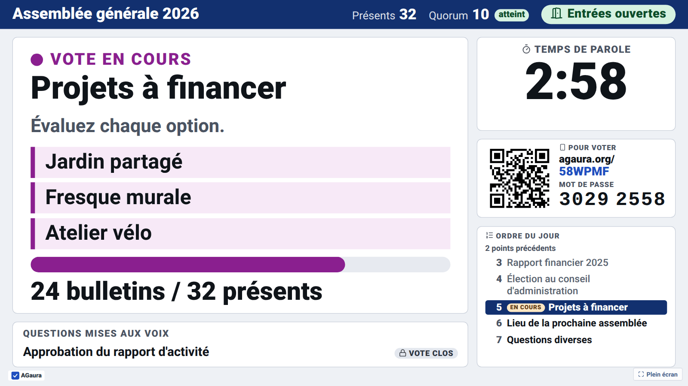
  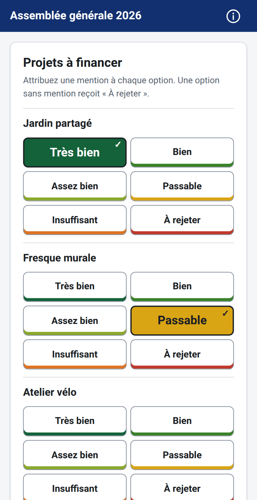
</p>

The interface is in French. The screenshots come from a scripted session
(`scripts/screenshots.py`) and show a real run of the application.

## Highlights

### No account for voters, secret ballot

- **Joining takes one scan.** The QR code shown in the room carries the session password in the
  URL fragment, which browsers never send to the server. Typing the address and the 8-digit
  password works too; for one vote per person, the tribune hands out printed cards with an
  individual code drawn at random.
- **Nothing ties a ballot to a voter.** A ballot stores neither the person, nor the device, nor
  the time. The record of who already voted has no link to the ballots and no timestamp either.
  Joins and votes never enter the session log, and access logs record neither request bodies
  nor sizes.
- **Even the order of arrival disappears.** When a poll closes, the database file is rebuilt in
  random-key order and its write-ahead log emptied; backups are refused while a poll is open.
  The answers of a ballot step, and with JavaScript its requests, are padded to one size per
  poll, so the length of the encrypted traffic does not give a choice away.
- **No partial result.** While a poll is open, the tribune and the room see turnout only.
- Every voter page lists these commitments behind its ⓘ button.

### Security

- HTTPS only with HSTS, a strict Content Security Policy, and not a single script, font or image
  from another host.
- Passwords hashed with argon2id; individual codes (keyed) and device tokens stored only as
  digests; session passwords and secret links encrypted.
- One vote per credential, enforced by a unique constraint in the same transaction as the ballot.
- Limits against guessing and scanning, sized for a room that shares one address (venue Wi-Fi,
  mobile carriers): access cap per session, entry lock, a headcount check that flags extra
  devices, a self-hosted anti-robot proof of work.
- Tamper evidence: each closed poll gets a SHA-256 fingerprint of its ballots, printed in the
  minutes; the audit log is hash-chained with a key derived from the master secret
  (`agaura audit verify`); the JSON export allows an independent recount
  (`scripts/recount.py`, [docs/EXPORTS.md](docs/EXPORTS.md)).
- Account isolation on every console query, tested on every route. Server hardening (Caddy
  limits, fail2ban, container limits) in [deploy/README.md](deploy/README.md); threat model in
  [docs/SPEC.md §9](docs/SPEC.md#9-ballot-secrecy-and-security).

### No personal data

- **Voters give nothing**: no name, no email address, no phone number. Their device keeps a
  random token in a cookie, cleared by « Quitter » and void once the session is closed.
- **The tribune account** holds an email address and an optional display name. Beyond that,
  the only names are those the tribune types itself: tribune members, candidates, delegate links.
- **No tracking**: no advertising, no audience measurement, nothing loaded from another site;
  cookies only for login, form protection and access to a session. IP addresses serve security
  only: the access log keeps them 7 days at most.
- Self-hosted: one Docker image, one SQLite file. Deleting an account deletes its sessions.

### Five ways to vote

<p align="center">
  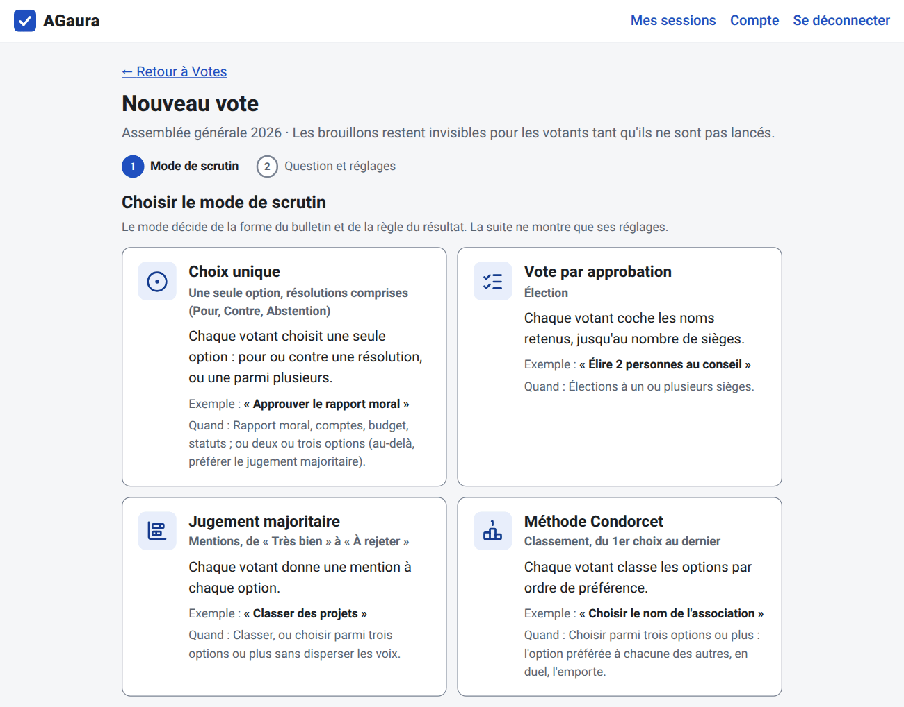
</p>

| Method (card) | Ballot | Result | Typical use |
|---|---|---|---|
| Résolution | « Pour » / « Contre », blank labelled « Abstention » | Adopted with more than half of the valid votes; 2/3, 3/4 or a custom threshold on request | Activity report, accounts, bylaws |
| Choix unique | One option | Most votes, or a threshold; base of valid votes, ballots cast or attendees | Venue, date |
| Vote par approbation | Tick up to N names | The N most approved, with an optional minimum threshold | Board elections |
| Jugement majoritaire | One grade per option, « Très bien » to « À rejeter » | Majority grade, Balinski–Laraki tie-break, merit profile | Ranking projects, three options or more |
| Méthode Condorcet | A rank per option, « 1er choix » to the last; ties and unranked options allowed | The option preferred to each other one in duels; a cycle settled by Schulze's strongest chains; matrix of duels | Choosing a name, three options or more |

A blank vote is always offered and counted apart from the valid votes. Ties are reported, never
broken by the software. Tallies use exact fractions, never floating point.

### Every task can be handed over

<p align="center">
  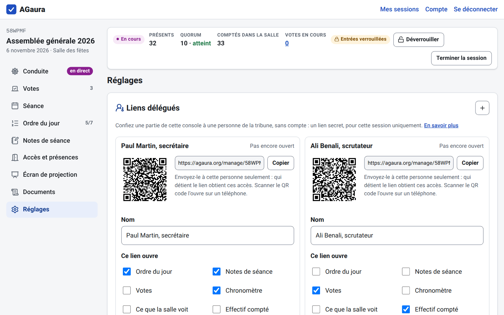
  
</p>

The account holder hands any running task of a session to someone without an account, through a
secret link or its QR code: **agenda**, **session notes**, **polls** (prepare, push, close,
publish), **chronometer**, **what the room sees** (hide or show each block of the projection
screen), **headcount**. Each card of the console has its « Confier » button.
The person sees only the rubrics of their rights, on a phone or a computer; the link works on
several devices, stops at once when revoked or when the session closes, and the session log names
the person next to each action. A delegate never gets the session password, the codes, the
documents or another session.

## How a session goes

### 1. Prepare

<p align="center">
  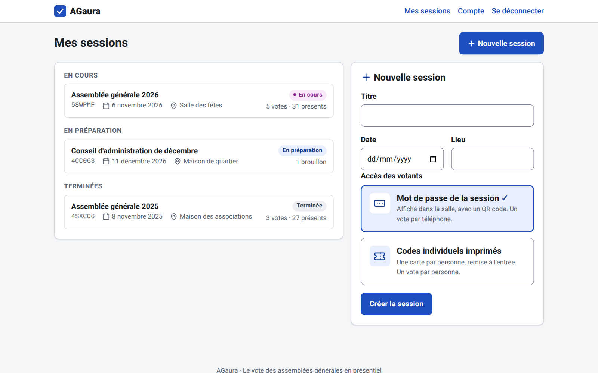
  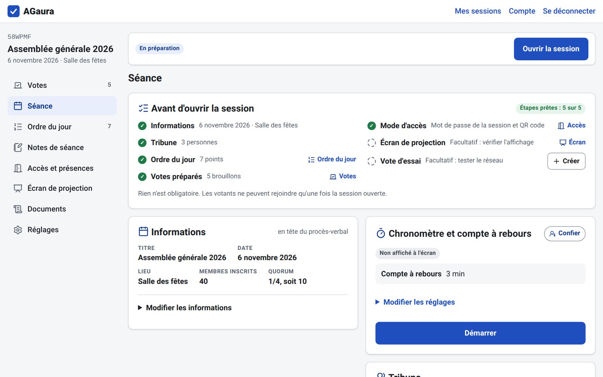
</p>

Create a session (title, date, place, access by session password or by printed codes; registered
members and quorum can follow in Séance), then follow the recap of the steps at the head of Séance:
tribune members and their functions, agenda (its own rubric), polls drafted ahead or copied from
last year, the projection screen tested, and an optional trial vote
« Tout le monde est-il connecté ? » that the minutes leave out.

### 2. Open: the room joins

<p align="center">
  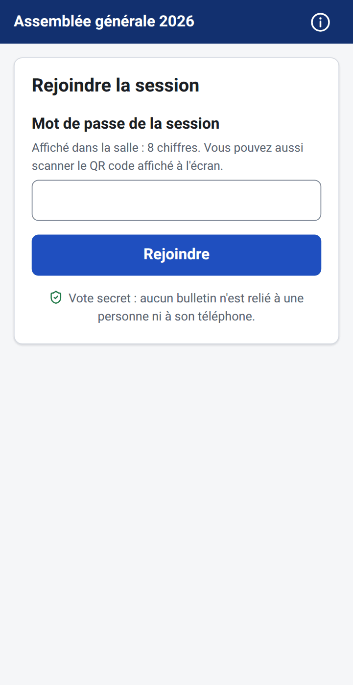
  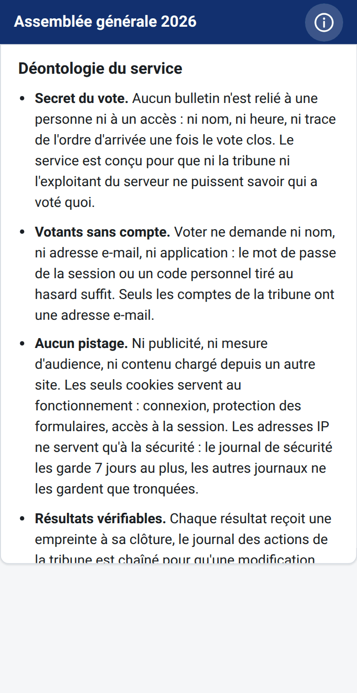
</p>

Opening the session puts the address, the QR code and the password on the projection screen
(top of this page). Phones scan and land on « En attente du prochain vote ». Once everyone is in,
locking the entries hides the password from the screen.

### 3. Vote

<p align="center">
  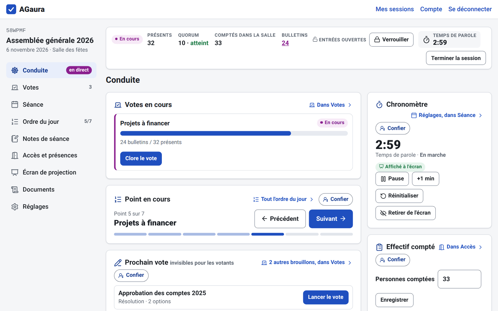
  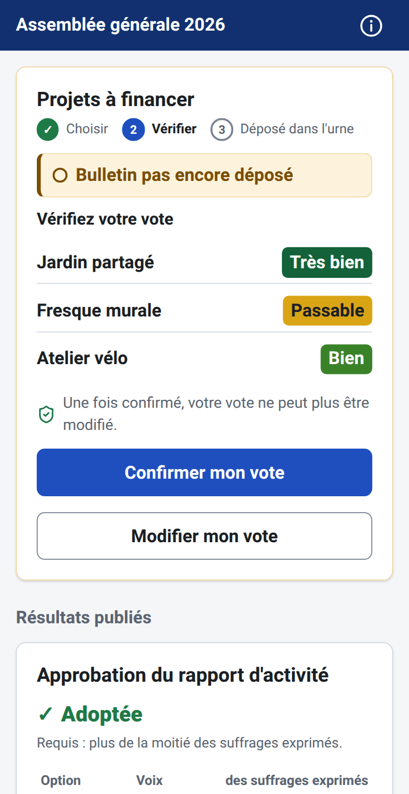
</p>

Steering gathers what the session needs at the moment: the polls open with their turnout, the
agenda item under discussion, the next poll to push, a quick note, the chronometer shown on the
screen, the headcount. A pushed poll appears on every phone within two seconds, without reloading.
Voters choose, check a summary, then confirm; the ballot is final.

### 4. Results

<p align="center">
  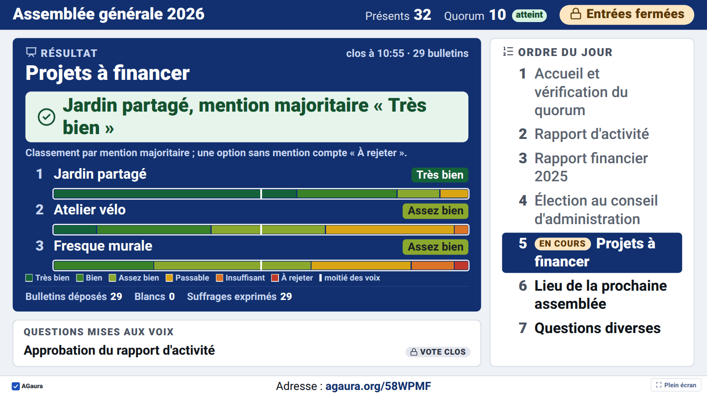
  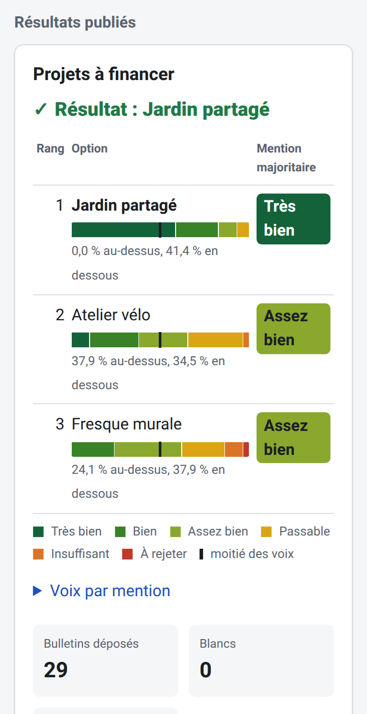
</p>

Closing a poll tallies it at once. The tribune then publishes the result to the phones and,
separately, shows it on the screen: the verdict always, the count of each option only from 10
ballots. The card « Ce que la salle voit » says in words what the screen shows, with a button
on each block to hide or show it: a result, the chronometer, the agenda, the QR code and the
password.

### 5. After the session

<p align="center">
  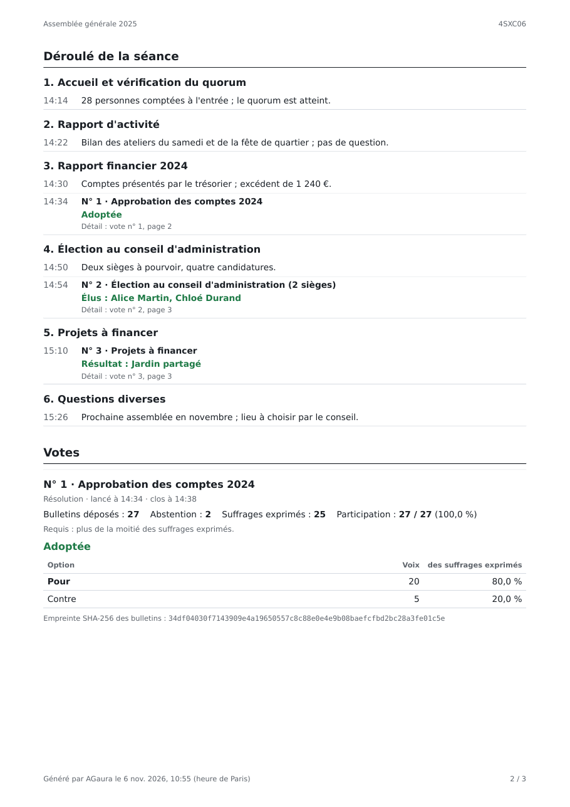
  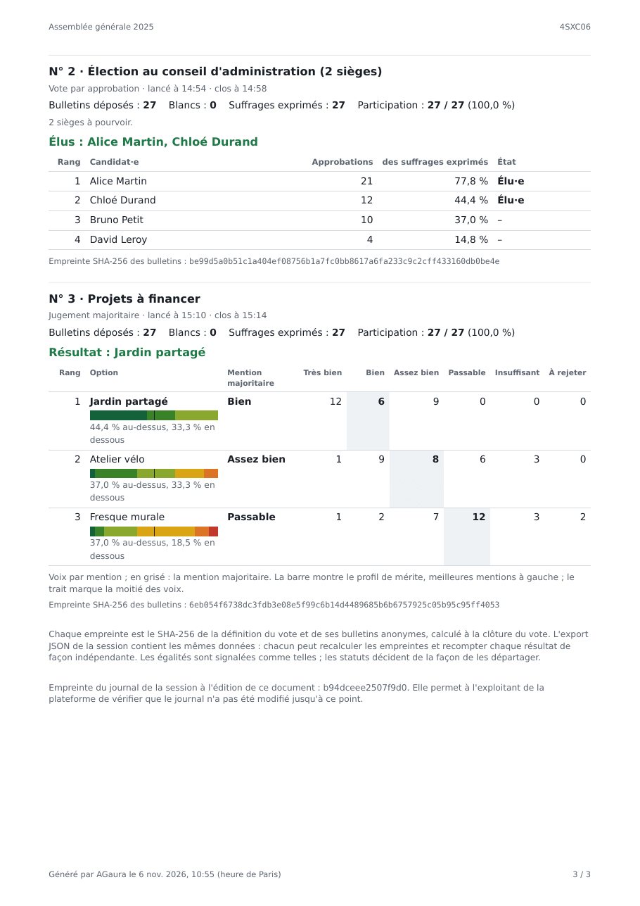
</p>

Closing the session voids every voter credential and ends delegate links. The account keeps the
history: PDF minutes (tribune, attendance record, course of the session item by item, detail of
each poll, fingerprints), the complete JSON export for an independent recount, the anonymous
ballots of each poll in CSV, and an optional secret link to share the results with members.

## Also included

- **Projection screen** behind a secret link: how to join, entries, attendees and quorum,
  agenda with the item under discussion, chronometer, live turnout; readable from 10 m.
- **Printed codes**: an A4 PDF of 10 cards with QR codes, for one vote per person; a session can
  switch to codes to rerun a contested vote.
- **Attendance**: attendees, quorum, headcount warnings, and readings at each poll for the
  minutes.
- **Session notes** attached to the agenda item, internal or for the minutes.
- **Several devices** for the tribune at once; the consoles follow each other live.
- **Resilience**: real-time updates with a polling fallback; a lost connection leaves the ballot
  in place; a confirmed ballot is never lost, even through a restart.
- **Without JavaScript**, ballots still work as plain forms; voter pages target WCAG 2.1 AA.
- **Accounts by invitation** from a super-admin, who never sees sessions; public signup as an
  option.
- **Demo**: « Essayer la démo » opens a temporary account with example sessions (5 voters per
  session, no export), deleted after 2 h without activity.

## Known limits

- With the session password, the guarantee is one vote per device, not per person: entry lock,
  access cap and headcount check limit and expose extra devices. Votes that require one voice per
  person use printed codes.
- A poll with very few ballots may reveal individual choices through its result.
- An operator able to change the code or read the live server's memory is outside the threat
  model ([docs/SPEC.md §9.1](docs/SPEC.md#91-threat-model)).

## Documentation

| Document | Content |
|---|---|
| [docs/SPEC.md](docs/SPEC.md) | What to build: requirements, voting methods, secrecy, security |
| [docs/PLAN.md](docs/PLAN.md) | In which order: phases and progress |
| [docs/WEB.md](docs/WEB.md) | Web conventions: files, console structure, real time, i18n, CSP |
| [docs/EXPORTS.md](docs/EXPORTS.md) | CSV, JSON and PDF formats; independent recount |
| [docs/LOCAL_TESTING.md](docs/LOCAL_TESTING.md) | A mock assembly with real phones on a local network |
| [docs/INSTALL.md](docs/INSTALL.md) | Installation on the server, updates, backups and restore, operator commands |
| [docs/RUNBOOK.md](docs/RUNBOOK.md) | Incidents: service down, damaged database, network outage in the room, leaked password, mistake in a poll |
| [deploy/README.md](deploy/README.md) | Server hardening: firewall, SSH, Caddy limits, fail2ban |

## Development

Requirements: Python 3.12, [uv](https://docs.astral.sh/uv/), Docker (optional).

```sh
uv sync                                      # create .venv with all dependencies
uv run uvicorn agaura.main:app --reload      # http://localhost:8000/health
uv run pytest --cov                          # tests with coverage
uv run ruff check && uv run ruff format --check
uv run python scripts/i18n.py check          # every interface string has a French translation
uv run python scripts/demo_session.py        # simulate two full sessions, print the results
uv run agaura audit verify                   # check the audit log hash chain (keyed)
uv run python scripts/recount.py export.json # recount a JSON export independently
uv run python scripts/screenshots.py         # regenerate the screenshots of this page
```

Browser tests (`tests/web/e2e/`, Playwright) need Chromium once:
`uv run playwright install chromium`; without it they are skipped. PDF documents (code cards,
minutes) use WeasyPrint, which needs Pango (`libpango-1.0-0`, present on most desktops; installed
in the Docker image). `scripts/screenshots.py` drives the same Chromium against a throwaway
database and writes `docs/screenshots/`; it uses `pdftoppm` (poppler-utils) for the minutes and
`pngquant` when installed.

Dependencies: the Python packages of `pyproject.toml` (locked in `uv.lock`); no JavaScript
package, no font and no asset from another host. Interface icons come from
[Lucide](https://lucide.dev) 1.60.0 (ISC License; shapes derived from Feather under the MIT
License), copied once into `agaura/static/icons.svg`, with their licence in
`agaura/static/LICENSE-icons.txt`.

The database is an SQLite file in `data/` (`AGAURA_DATA_DIR`), created and migrated when the
application starts or with `uv run agaura db upgrade`. After changing the models:
`uv run alembic revision --autogenerate -m "Describe the change"`.

### Trying the application with phones

```sh
uv run python scripts/dev_seed.py                       # accounts, a session, a past session
uv run uvicorn agaura.main:app --host 0.0.0.0 --port 8000 --reload
```

`dev_seed.py` prints the logins: `demo@agaura.local` / `demo-password-2026` (tribune) and
`superadmin@agaura.local` / `superadmin-password-2026`. Then follow
[docs/LOCAL_TESTING.md](docs/LOCAL_TESTING.md). Emails are printed in the server's terminal.

### Docker (app behind Caddy)

```sh
cp .env.example .env
mkdir -p -m 700 backups/auto                 # automatic backups, outside the volumes (uid 1000)
docker compose up --build                    # https://localhost (Caddy's local certificate)
curl -k https://localhost/health
docker compose exec app agaura user create admin@example.org --superadmin   # then /login
```

If ports 80 and 443 are taken, set `HTTP_PORT` and `HTTPS_PORT` in `.env`. Caddy also writes its
access log to `./logs/caddy/` (`CADDY_LOG_DIR`), read by fail2ban on the server.

## Installation on a VPS (over SSH)

The short path from an empty VPS to a running site. Every step in detail, then updates, logs,
backups, restore and operator commands: [docs/INSTALL.md](docs/INSTALL.md); server hardening:
[deploy/README.md](deploy/README.md).

Needed: a Debian or Ubuntu VPS (2 vCPU, 2 GB RAM) with SSH access, a domain whose `A` record
points to the VPS (`dig +short agaura.org` returns its address), and an SMTP mailbox for the
invitations. Below, `VPS` stands for the server's address and `agaura.org` for the domain.

**1. SSH key.** From the development machine:

```sh
ssh-copy-id root@VPS                 # or the user created by the hosting provider
ssh root@VPS
```

**2. Prepare the server**, as root (`sudo -i` when logged in as another user), once: a sudo user
with the same key, the firewall, Docker. On an Infomaniak Debian image the sudo user `debian`
exists already: skip the first three lines and write `debian` for `agaura-admin` below
(docs/INSTALL.md §3).

```sh
adduser agaura-admin && usermod -aG sudo agaura-admin
mkdir -p /home/agaura-admin/.ssh && cp ~/.ssh/authorized_keys /home/agaura-admin/.ssh/
chown -R agaura-admin: /home/agaura-admin/.ssh
apt update && apt install -y curl ufw rsync git unattended-upgrades
ufw allow 22/tcp && ufw allow 80/tcp && ufw allow 443/tcp && ufw allow 443/udp && ufw --force enable
curl -fsSL https://get.docker.com | sh   # Docker Engine 27+ and Compose; or the apt repository of docs.docker.com/engine/install
usermod -aG docker agaura-admin
mkdir -p /srv/agaura && chown agaura-admin: /srv/agaura
```

Check that `ssh agaura-admin@VPS` works from another terminal, then close the door to passwords
and to root: `PasswordAuthentication no` and `PermitRootLogin no` in `/etc/ssh/sshd_config`,
`systemctl reload ssh`. Open the same ports in the provider's firewall when it has one.

**3. Send the code.** Once the repository is published, on the server: `git clone` into
`/srv/agaura` and check out the latest version tag ([docs/INSTALL.md](docs/INSTALL.md) §4);
`deploy/update.sh` needs that checkout for later updates. Until then, copy the working tree from
the development machine, in the repository's directory; the files listed in `.gitignore`
(`.env`, `data/`, `backups/`, `logs/`) are neither sent nor deleted on the server:

```sh
rsync -az --delete --exclude-from=.gitignore --exclude=.git --exclude=.claude ./ agaura-admin@VPS:/srv/agaura/
```

**4. Configure and start**, on the server (`ssh agaura-admin@VPS`):

```sh
cd /srv/agaura
mkdir -p -m 700 backups/auto && { [ "$(id -u)" = 1000 ] || sudo chown 1000:1000 backups/auto; }
cp .env.example .env && chmod 600 .env
python3 -c "import secrets; print(secrets.token_urlsafe(48))"   # the master secret
nano .env                                                       # the values below
```

```ini
AGAURA_ENVIRONMENT=production
# Keep a copy outside the server: a lost secret breaks session passwords, codes and the audit log.
AGAURA_SECRET_KEY=the-generated-secret
AGAURA_BASE_URL=https://agaura.org
AGAURA_DOMAIN=agaura.org
AGAURA_EMAIL_BACKEND=smtp
AGAURA_SMTP_HOST=mail.infomaniak.com
AGAURA_SMTP_PORT=465
AGAURA_SMTP_USERNAME=no-reply@agaura.org
AGAURA_SMTP_PASSWORD=the-mailbox-password
AGAURA_EMAIL_FROM="AGaura <no-reply@agaura.org>"
# Public repository of the running code (AGPL, section 13).
AGAURA_SOURCE_URL=https://the-public-repository
CADDY_LOG_DIR=/srv/agaura/logs/caddy
```

```sh
docker compose up -d --build
docker compose ps                         # app "healthy", caddy "Up"
curl https://agaura.org/health            # {"status":"ok",…}; certificate obtained on the first request
docker compose exec app agaura user create admin@agaura.org --superadmin
```

The super-admin logs in at `https://agaura.org/login` and invites the first account by email.
Then install fail2ban ([deploy/README.md](deploy/README.md) §2–3) and go through the final
check ([docs/INSTALL.md](docs/INSTALL.md) §9).

**Updating a copy sent with rsync** (no tag, so no `deploy/update.sh`): with no session in
session (`docker compose exec app agaura stats`), take a copy of the database by hand
([docs/INSTALL.md](docs/INSTALL.md) §10, "Backup and restore"), run the same `rsync` again,
then `docker compose up -d --build` on the server (migrations apply at start). Never
`docker compose down -v`: it deletes the database and the certificates.

## Configuration

Environment variables, read from `.env` (see `.env.example`):

| Variable | Default | Role |
|---|---|---|
| `AGAURA_ENVIRONMENT` | `development` (`production` in the Docker image) | `production`: HTTPS-only cookies, HSTS, no `/docs`, real secret required; `development` is refused with a public base URL or domain |
| `AGAURA_SECRET_KEY` | development key | Master secret (32+ characters); encrypts session passwords, derives code digests and the audit log's chain key. Changing it makes stored passwords and codes unusable and the existing log fail `agaura audit verify` |
| `AGAURA_BASE_URL` | `http://localhost:8000` | Public address, used in emails and code cards; in production on a public address, `https://` followed by `AGAURA_DOMAIN` |
| `AGAURA_DATA_DIR` | `data` (`/data` in Docker) | SQLite database directory |
| `AGAURA_SIGNUP` | `closed` | `open` allows public signup, with the anti-bot check |
| `AGAURA_CONTACT_EMAIL` | `contact@agaura.org` | Address shown on the home page, `/login` and `/signup` to ask for an account while signup is closed |
| `AGAURA_DEMO`, `AGAURA_DEMO_MAX` | `true`, `50` | Demo accounts (« Essayer la démo »), at most `AGAURA_DEMO_MAX` at once; `false` turns them off |
| `AGAURA_SOURCE_URL` | none | Public repository of the running code, linked from the home page, the footer and the voter pages (AGPL, section 13) |
| `AGAURA_EMAIL_BACKEND` | `console` | `smtp` to send (`console` is refused in production on a public address); `AGAURA_SMTP_HOST`, `_PORT`, `_USERNAME`, `_PASSWORD`, `AGAURA_EMAIL_FROM` |
| `AGAURA_DOMAIN` | `localhost` | Domain served by Caddy (`www` redirected); the application only checks it is local in development |
| `HTTP_PORT`, `HTTPS_PORT` | `80`, `443` | Host ports published by Caddy |
| `CADDY_LOG_DIR` | `./logs/caddy` | Host directory of Caddy's access log (fail2ban) |
| `BACKUP_DIR` | `./backups/auto` | Host directory of the automatic backups (Docker); must exist, owned by uid 1000 |
| `AGAURA_BACKUP_DIR`, `AGAURA_BACKUP_KEEP_DAYS` | none (`/backups` in Docker), `30` | Automatic backups: a copy once a day and after each poll closing, never during a vote; off when unset |

## Status

Local development: phases P0 to P6 done (tallying, data, accounts, voter page, console and
projection screen, results and exports), plus the review before going online: tribune, agenda,
chronometer, notes, attendance readings, super-admin, console in rubrics, limits against
guessing and scanning, server hardening configuration. Human verification on real phones
pending. Not deployed: going online (P0-online, [docs/INSTALL.md](docs/INSTALL.md)), operations
(P7) and validation (P8) come next.

## License

Copyright (C) 2026 AGaura contributors.

AGaura is free software: it can be redistributed and modified under the terms of the
[GNU Affero General Public License](LICENSE), version 3 or (at the user's option) any later
version. It comes without any warranty. Whoever runs a modified version as an online service
must offer its users the corresponding source code (section 13 of the license).
