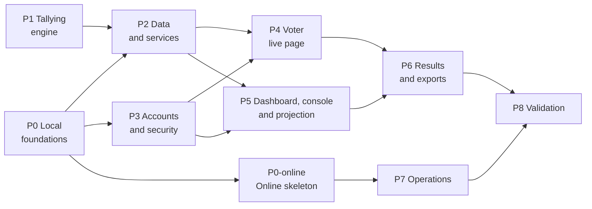

# AGaura — v1 Delivery Plan

> Status: **approved** · Version 1.3 · 2026-11-05
> Functional reference: [SPEC.md](SPEC.md) (FR-xx and NFR-xx identifiers refer to it)
>
> Changes since 1.2: the local part of P7 is done (SPEC 1.9): automatic backups, restore script tried under Docker, retention (D12), email failures for the operator, JSON logs, incident runbook; what needs the server or outside information stays open; see Progress.
>
> Changes since 1.1: the Condorcet method (Schulze, *winning votes*) joins v1 after P6 (SPEC 1.6), as the module of P1 allowed; see Progress.
>
> Changes since 0.3: decisions recorded; development starts locally; P0 split into local foundations (P0) and the online skeleton (P0-online), run when the project is ready to go online.
>
> Changes since 0.2: three voting methods in v1; Condorcet-Schulze removed from P1, P4 and P6.
>
> Changes since 0.1: P3 becomes self-service accounts (email verification and recovery) instead of organizations and invitations; P5 adds the dashboard, quick poll creation and live control; the application moves to the `agaura.org` apex.

## Principles

- **Walking skeleton online in phase 0**: DNS, VPS, HTTPS, email and deployment are proven before any business code is written.
- **Tallying first**: the voting algorithms, the most critical part, are built and tested in isolation, with no database and no web layer.
- **Verifiable exit criterion** for every phase. No phase is done without it.
- **Account isolation tested continuously**, from the first admin route onwards.
- **No deployment while a session is in session.**

Relative size per phase: **S** (small), **M** (medium), **L** (large).

## Overview

P0 and P1 can run in parallel. Development and tests run locally until the project is ready to go online; then P0-online and P7 run, and both must be finished before P8.

## Phases

### P0 — Local foundations · S

- Initialize the local git repository (the GitHub remote comes later): `README`, `.gitignore`, project `CLAUDE.md` (everything in English except the UI, testing conventions).
- Create the Python project with `uv`: minimal FastAPI app, `/health` route, settings from the environment, ruff, pytest.
- Write the `Dockerfile` (multi-arch amd64/arm64), `compose.yaml` (app + Caddy), `.env.example`.
- Write the GitHub Actions CI workflow (lint, tests, image build); it runs once the remote exists.

**Exit**: `uv run pytest` and `uv run ruff check` pass; `docker compose up` serves `https://localhost/health` through Caddy.

### P0-online — Online skeleton · S

Run when the project is ready to go online; required before P8.

- Push to the GitHub remote; CI green.
- Prepare the VPS: non-root user, key-only SSH, firewall (22/80/443) on the system and in the Infomaniak Manager, automatic updates, Docker, fail2ban with the AGaura jails (`deploy/README.md`).
- Configure DNS: A/AAAA for `agaura.org`, CNAME for `www` (redirected to the apex).
- Set up Infomaniak email for `agaura.org` (D13); add SPF, DKIM and DMARC records; send a test email.
- Install following [INSTALL.md](INSTALL.md) (start, super-admin, fail2ban, final check); try the update script (`deploy/update.sh`, written locally) with a first published version.

**Exit**: `curl https://agaura.org/health` returns 200 with a valid certificate; `www.agaura.org` redirects to the apex; a test email from `no-reply@agaura.org` reaches Gmail and Outlook inboxes (not spam) with SPF, DKIM and DMARC passing; CI is green.

### P1 — Tallying engine · M

`agaura/voting/` module, pure Python, no I/O at all.

- Define ballot and result types for each method, with ballot validation (FR-44).
- Implement the three methods of §6: single choice (bases and thresholds), approval (seats, max choices, threshold), Majority Judgment (majority grade and majority value).
- Handle blank ballots and tie detection, shared by all three methods.
- Design the module so that a new method (e.g. Condorcet later) only needs one tally module and one ballot template.
- Reference tests:
  - Majority Judgment, the published Tennessee capital example (Wikipedia, 4 grades, 100 voters → Nashville);
  - single choice, every base × threshold combination, including the Resolution template;
  - approval, ties at the N-th seat and minimum threshold;
  - edge cases: no ballots, only blank ballots, a single option receiving votes, perfect ties.
- Property tests (Hypothesis):
  - no method depends on ballot order;
  - single choice: votes per option add up to valid votes;
  - approval: the sum of approvals equals the total number of checked boxes;
  - Majority Judgment: if every voter grades A at least as high as B, and at least one strictly higher, A ranks strictly above B.

**Exit**: 100% test coverage of the module; ballot and result formats documented in docstrings.

### P2 — Data and services · M

- Write the SQLAlchemy models and the first Alembic migration, following the data model of §8 (`ballot` and `participation` as `WITHOUT ROWID`).
- Apply the SQLite settings on every connection: WAL, `synchronous=FULL`, `foreign_keys`, `busy_timeout`.
- Write the services:
  - sessions (assemblies) and state transitions, session ID generation (at least one digit);
  - voter access: session password (encrypted storage, regeneration), device credentials, code batches (generation, HMAC, revocation), entry lock, headcount check;
  - polls and state transitions, visibility flags (voters / screen);
  - `cast_vote` (atomic participation + ballot transaction);
  - closing (tally, digest, stored result);
  - hash-chained audit log;
  - email outbox with retries.
- Add an `agaura audit verify` command.
- Tests:
  - double voting impossible, including 50 concurrent submissions with the same credential;
  - every forbidden state transition is refused; joins refused when locked or not in session;
  - **crash test**: hard kill (`kill -9`) during a voting burst, then check that every confirmed vote is in the database;
  - **anonymity test**: no column links ballot and credential, no timestamp on ballots, participations or credentials;
  - audit chain verification, and detection of a tampered entry.

**Exit**: a demo script runs a full session (creation, joins in both access modes, 4 polls, votes, closings) and prints the results.

### P3 — Accounts and security · M

- Signup with ALTCHA anti-bot, email verification (FR-01, FR-02).
- Login and logout, server-side sessions, "log out everywhere" (FR-03).
- Password reset by email, email change with confirmation, display name, account deletion (FR-04 to FR-06).
- Quotas per account, adjustable through the CLI (FR-08).
- French email templates sent through the outbox.
- Harden: CSRF, rate limiting (signup, login, reset, joins), security headers and CSP.
- Write a FastAPI dependency that provides the current user to every admin route.
- **Isolation tests**, generated automatically: for every admin route, account A tries to reach sessions, polls and exports of account B and must get a 404.
- Operator CLI: disable an account, delete a session, change quotas, statistics.

**Exit**: isolation tests pass; full account journey (signup → verification → login → reset → deletion) passes end to end with real emails; no admin route is reachable without a valid session.

### P4 — Voter live page · L

- Join page `agaura.org/{session_id}`: password or code form, automatic join from the `#k=` fragment, forgiving input (FR-24), credential cookie, refusal when locked.
- Live page showing **only** open polls and results published to voters, otherwise the waiting screen (FR-41).
- Mobile ballots for the three methods (§6.6), summary, submission, blank option, "Quitter" button (named "Terminer" until the 2026-11-03 review).
- No-JavaScript fallback: plain forms for the three methods, manual refresh.
- Real time:
  - in-memory fan-out per session;
  - SSE stream with heartbeat;
  - polling fallback;
  - automatic reconnection.
- Playwright end-to-end tests, in a mobile viewport, on the main journeys.
- Testing on real devices: recent and older iPhone, recent and entry-level Android.

**Exit**: on a real phone (over the local network during local development, then over 4G once online), scanning the QR code joins the session without typing; a poll pushed by the admin appears within 2 s (NFR-03); a vote succeeds for each of the three methods.

### P5 — Dashboard, session console and projection screen · L

- Dashboard: history of the account's sessions (FR-10), session creation (FR-11), copy of polls from a past session (FR-15).
- Session console, access panel: password display and regeneration, codes mode with card PDF (WeasyPrint + segno, 10 cards per page, cut marks), entry lock (FR-27), headcount check and warnings (FR-28), screen and public results links.
- Poll editor: full form and **quick creation on a phone** (FR-31), drafts, reordering, duplication.
- Live control:
  - opening and closing the session;
  - pushing, closing and cancelling polls;
  - timers;
  - live turnout and quorum;
  - publishing results to the screen and/or voters, and dismissing them.
- Projection screen (FR-70 to FR-73), readable from 10 m, with password and QR code hidden once entries are locked.
- Audit log viewer (session and account).

**Exit**: one person, alone, runs a full mock session from a phone (quick creation of 4 polls on the fly), with three voter phones and a projection screen, without touching the database or the command line.

### P6 — Results and exports · M

- Result pages per method:
  - bars for single choice and approval;
  - merit profile for Majority Judgment.
- Public results link (FR-17).
- CSV (random order), JSON (documented format) and PDF minutes exports; SHA-256 digest displayed.
- Recount test: recomputing every result from the JSON export must yield an identical result.

**Exit**: the PDF minutes of the P5 mock session are generated and proofread; the recount test passes for all three methods.

### P7 — Operations · M

- Backups: hot database copy to a dedicated directory on the VPS (outside the Docker volume), scheduled daily and after every poll closing, 30-day retention. Off-site copy (encrypted restic) added later.
- **Restore test**, following the written procedure.
- External monitoring of `/health`, with email alerts.
- Logs: JSON format, rotation, 7-day retention, truncated IPs; strip the tokens of `/verify/…`, `/reset/…`, `/account/email/…`, `/…/screen/…` and `/…/results/…` paths from access logs (Caddy filter and no uvicorn access log already in place; check them on the VPS).
- Email: bounce handling, delivery failures visible to the operator.
- Scheduled purge of inactive accounts, with a warning email beforehand (D12).
- Deployment script with a guard: refuses to run while a session is in session.
- Legal notice and privacy pages.
- Incident runbook (`docs/RUNBOOK.md`):
  - VPS unavailable;
  - corrupted database;
  - mobile network outage in the room;
  - session password leaked outside the room;
  - mistake in an open poll.

**Exit**: full restore from a backup succeeds in under 1 h; an alert is received when the service is stopped on purpose.

### P8 — Validation · M

- Locust load tests, run from a machine outside the VPS:
  - 1,000 SSE connections held for 30 min (NFR-01);
  - burst of 300 votes in 30 s (NFR-02);
  - push latency under 2 s with 1,000 connected voters (NFR-03);
  - 5 sessions in session at once.
- Security review: OWASP checklist, review of the voting, access and authentication code.
- Abuse scenario: one tester joins several times through private windows before the lock; check that the headcount warning appears and that joining is refused after the lock.
- Accessibility audit of the voter pages (NFR-06).
- **Dress rehearsal** in a real room, with 20 to 50 phones and at least 3 different mobile carriers.
- Session kit:
  - admin checklist for before, during and after the session;
  - paper fallback procedure.

**Exit**: NFR-01 to NFR-03 met; the rehearsal runs without blocking issues; go / no-go decision for the first real assembly.

## Milestones

| Milestone | Content | End of phase |
|---|---|---|
| **M0** | Local skeleton running (tests, Docker, Caddy) | P0 |
| **M0-online** | Skeleton online at `agaura.org`, email delivered | P0-online |
| **M1** | Tallying engine validated | P1 |
| **M2** | First poll pushed and voted on a phone | P4 |
| **M3** | Full mock session run from a phone, with minutes | P6 |
| **M4** | Ready for a real assembly | P8 |

## Risks

| Risk | Impact | Mitigation |
|---|---|---|
| Poor mobile coverage in a room | Some voters cannot vote | On-site test before any new room; hotspot; voting on a steward's device; paper fallback |
| Repeat votes from private windows or second phones (password mode) | Inflated results | Entry lock (FR-27); headcount warning (FR-28); codes mode for binding votes |
| Session password leaked outside the room | Outsiders vote | Password hidden after the lock; regeneration; codes mode |
| Bug in a tallying algorithm | Wrong result, dispute | Reference and property tests (P1); recount from the JSON export (P6) |
| Data leak between accounts | Severe loss of trust | Centralized owner filtering; automatic isolation tests on every route (P3) |
| Recovery emails landing in spam | Locked-out admins | Reputable provider; SPF, DKIM, DMARC (P0); deliverability test |
| Signup abuse (bots, spam content) | Load, illegal content under `agaura.org` | ALTCHA, email verification, quotas, operator CLI, legal contact page |
| VPS failure mid-session | Voting interrupted | Documented recovery; backup after every poll; paper fallback |
| Backups kept on the same VPS (for now) | Losing the VPS loses data and backups | Admins download exports after each session; off-site copy planned |
| Server overload | Slowness, errors | Load tests (P8); VPS can be resized at Infomaniak |
| Credential ↔ ballot link reintroduced by mistake (log, timestamp) | Ballot secrecy broken | Automated anonymity test (P2); targeted review (P8) |

## Decisions recorded (2026-11-02)

- VPS: Infomaniak, 4 vCPU, 12 GB RAM, 250 GB disk.
- Email provider: Infomaniak (D13).
- Backups: on the VPS for now; off-site copy later.
- Defaults D1 to D13 approved ([SPEC.md §1.3](SPEC.md#13-defaults-approved)).
- Development runs locally first; going online happens when the project is ready.

## Progress

| Phase | State | Evidence |
|---|---|---|
| P0 | Done (local) | Tests and ruff pass; `docker compose up` serves `/health` through Caddy |
| P1 | Done | 100% coverage of `agaura/voting/`; Tennessee example; Hypothesis properties |
| P2 | Done | `scripts/demo_session.py`; crash, concurrency (50 submissions), anonymity and audit tests |
| P3 | Done (local) | Signup with proof-of-work, verification, reset, account settings, operator CLI; generated isolation tests on every console route. Real email delivery waits for P0-online |
| P4 | Done (local), human check pending | Voter join and live page, three ballots, SSE with polling fallback, no-JS forms; Playwright journeys in a phone viewport (push visible < 2 s). Real phones: [LOCAL_TESTING.md](LOCAL_TESTING.md) |
| P5 | Done (local), human check pending | Dashboard and console (split into modules); full poll editor usable on a phone, draft order, copy from a past session; card PDF (10 per A4 page, crop marks); projection screen (secret link, SSE, readable from 10 m, password and QR code hidden when entries are locked); screen and public results links. Playwright journeys in phone and 1920×1080 viewports. Exit run from a phone: [LOCAL_TESTING.md](LOCAL_TESTING.md) |
| P6 | Done (local) | Result display per method (bars, merit profile); public results page; CSV (random order, `;`, BOM), JSON (documented in [EXPORTS.md](EXPORTS.md)), PDF minutes; `scripts/recount.py` and recount tests for the three methods, blanks and ties |
| Review (2026-11-03) | Done (local), human check pending | Requested before going online (SPEC 1.1): tribune with free functions (FR-18), agenda (FR-19), chronometer (FR-74); projection screen without results (FR-70 to FR-73); latest poll on top of the voter page (FR-41); minutes without signature lines (FR-62); super-admin managing accounts by invitation, with no access to sessions, and public signup closed (FR-01, FR-07, FR-09); then simpler chronometer and tribune forms, attendance readings (FR-28) and session notes in the minutes (FR-90); console reorganized in rubrics with a status bar and a Pilotage rubric following the state of the session (FR-91); limits against guessing and scanning (FR-25, §9.3: 8-digit passwords, IPv6 by /64, no session lockout, tribune alert, unknown IDs), Caddy limits and fail2ban configuration |
| Delegate links (2026-11-03) | Done (local), human check pending | SPEC 1.2, FR-92: a secret link per person opens part of the console of one session without an account (agenda, session notes, polls, chronometer, headcount); key in the URL fragment then an `HttpOnly` cookie of the session path; revocable, ended when the session closes; actions logged as the delegate's. Test generated over every console route (`DELEGABLE`), Playwright journey on a phone. Manual check: [LOCAL_TESTING.md](LOCAL_TESTING.md) "Delegate links" |
| Demo and contact (2026-11-05) | Done (local), human check pending | SPEC 1.4, FR-09a: "Essayer la démo" opens an account of one's own, without email or password, holding a session in preparation and a closed one with its results; login of 2 h without activity, 24 h at most, then the account and its sessions are deleted (background job every minute, or at once on "Terminer la démo"); 5 per address an hour, 50 at once; 5 voters per demo session in either access mode, no export (buttons greyed out, routes refused), every limit written out where it applies (`/demo`, account page, bands, card "Entrées", status bar, refusal message); out of the super-admin page, the deployment guard and the backup guard. FR-01: the home page and `/signup` give `contact@agaura.org`. Migrations now run with SQLite's foreign keys off and checked before the commit: rebuilding a table (batch mode) deleted the rows referring to it in cascade (0007 removed every option and ballot of an existing database) |
| Updates and method cards (2026-11-05) | Done (local), run against a test repository pending | SPEC 1.5. `deploy/update.sh` (INSTALL §10): published versions only (tags `vX.Y.Z`), refused while a session other than a demo is in session; the image is built while the current version serves, the database backed up, then the new version must report its number on `/health` and verify the audit log, or the previous image, code and database come back; `--rollback` undoes the last update. `agaura stats` counts demo sessions apart; a test checks that `__init__.py`, `pyproject.toml` and `uv.lock` carry one version number. FR-31: no method card set apart |
| Condorcet method (2026-11-05) | Done (local), human check pending | SPEC 1.6, §6.5: `agaura/voting/condorcet.py` (duels, Schulze *winning votes* by Floyd-Warshall, ranking by groups of unbeaten options, Condorcet winner), 100% coverage, the 45-voter Wikipedia example (E > A > C > B > D) and Hypothesis properties (the ranking follows the strongest paths; the Condorcet winner always wins). Fifth card of the editor; a list of ranks per option on the phone, ties and unranked options allowed, without JavaScript too; summary best first; padding of the ballot steps extended and walked over every ranking of small polls; result with duels won and lost, matrix of duels and, after a cycle, of the strongest chains (console, voter page, public page, minutes), rank and duels won on the projection screen; CSV of ranks; recount; a Condorcet poll in the demo sessions. Manual check: [LOCAL_TESTING.md](LOCAL_TESTING.md) "Polls" and "Results and exports" |
| What the room sees (2026-11-05) | Done (local), human check pending | SPEC 1.7: a small "Masquer" / "Afficher" button on each line of "Ce que la salle voit" (a result shown or not, the chronometer, the agenda, the way to join while entries are open), one route `POST …/screen/show`, the card's list a live part of the console whose buttons act in place; agenda and way to join hidden apart from the lock (migration 0009, logged), the password then kept off the screen; sixth delegate right `screen`, that card and its buttons without the screen link, "Confier" in its head. Manual check: [LOCAL_TESTING.md](LOCAL_TESTING.md) "Projection screen" |
| AG test on the demo (2026-11-05) | Done (local) | Five testers (chair, delegated secretary with the projection screen, three voters on five phones, one without JavaScript, one keyboard only) ran two sessions on a test server where the demo could export: 40 ballots, 0 difference between the intents, the exports and the results; recount and audit chain OK; axe-core 0 violation on 26 pages; every tampered request refused; sizes of ballot steps constant. Fixed after it (SPEC 1.8): consoles never told a poll had closed (FastAPI writes event data as JSON), a crowded projection screen fell to tiny type, results kept after the closing on the devices that took part, closing time to the second, trial vote first and counted nowhere, "Résolution" named everywhere, the editor's hint following the base, the join field marked and focused after a refusal, the demo band without JavaScript, French typography with no-break spaces, wording. Not retained: a trial vote set apart on the screen, a more explicit session log, a one-time page for codes |
| P7, local part (2026-11-05) | Done (local), to repeat on the VPS | SPEC 1.9. Automatic backups by the application (`agaura/backups.py`): once a day and within a minute of each poll closing, never while a poll of a real session is open, into `backups/auto/` on the host (bind mount, outside the data volume; the start fails while it is missing), mode 600, 30 days, the latest always kept, skipped when the disk is nearly full; `agaura db backups`, latest time on `/health` from inside. `deploy/restore.sh NAME\|FILE`: `agaura db check` first (integrity, migrations on a temporary copy, audit log), refused in session unless `--force`, safety copy, damaged files moved aside when they cannot be copied. Tried under Docker (separate project, production settings): automatic copy 1 min after a closing, restores from an automatic backup and from a host file, refusal in session, `--force` over a database with 30 pages overwritten; 7 to 10 s without service each time. Retention every hour (`agaura/services/retention.py`): expired logins, used or long-expired email links, emails sent 30 days ago or given up 90 days ago; D12 warning 30 days before deleting an account inactive for 3 years. Email recipients refused for good (5xx) given up at once; `agaura email failed` / `retry`. JSON log lines in production (`agaura/logs.py`); database errors of the CLI as a message, not a traceback. `docs/RUNBOOK.md` |
| Owner's review (2026-11-06) | Done (local), human check pending | SPEC 1.10, six changes made in parallel: the steering rubric renamed « Conduite », absent before the opening (the console lands on Séance, headed by a compact recap of the steps); the poll editor with four cards, "Résolution" a form of "Choix unique" (switch in place or by form), two empty options, no hint "2 à 30", the blank vote's label fixed; the blank vote on the ballot drawn like the options for the four methods, a ballot with both refused without JavaScript; the agenda as one text field saved in place (`agenda.js`, `GET …/agenda`), a text being typed never replaced by another console's edit; the projection screen's way to join on one row beside other blocks (428 → 218 px at 1920×1080); creating a session without registered members or quorum; "Confier" a stable toggle with a floating panel (card height and toggle position unchanged in its 11 places, computer and phone); then Séance split in three rubrics, Séance (details, tribune, the recap before the opening), Ordre du jour and Notes de séance, the phone tabs led by the rubric the console lands on. Then the delegate links of Réglages unfolded: one tile per link (address, QR code, name and rights in view, "Enregistrer" and "Retirer le lien"), a "+" in the card's head for a new link. The chronometer's card moved to Séance, above the tribune (a delegate link holding it keeps it in Écran de projection); the Majority Judgment grades stay in words (D8), the owner's choice. Then every poll of Votes a tile folded by default, title and state in view (`macros/polls.html`, live part `poll-tiles`), and blank ballots counted under the ballot's own words |
| P0-online, rest of P7, P8 | Not started | The whole logic verified locally, the repository is published (first push, 2026-11-06), after a last security review (authorization, ballot secrecy, operations). Still to do for P7: restore test on the VPS (exit criterion), external monitoring of `/health` with email alerts, legal notice and privacy pages (publisher and host details needed), bounces arriving by email (mailbox of the sender), off-site copy later. Done early: secret path tokens filtered from Caddy's access log, uvicorn access log off in the image |

Implementation notes from P2, reflected in SPEC §8: the projection screen and public results links are stored encrypted (like the session password) so the console can show them again; options are identified by their position; switching a session to codes mode disables password-mode devices; the audit log has no foreign keys, so deletions never break the chain.

## Still open (needed for P0-online)

- [ ] Email address of the super-admin, created on the VPS with
      `docker compose exec app agaura user create EMAIL --superadmin` (then a password typed on
      the server).
- [ ] VPS OS and SSH access (key already installed, or initial password).
- [ ] GitHub remote: account or organization, public or private.
- [ ] Server admin email address for monitoring alerts.
