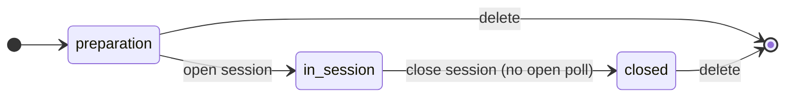
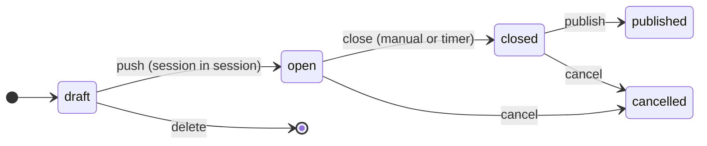
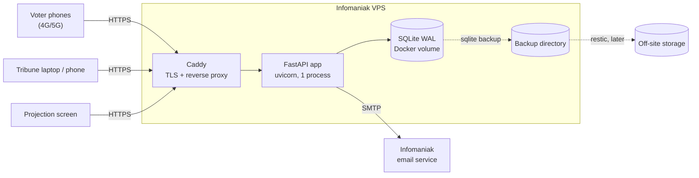

# AGaura — Specification v1

> Status: **approved** · Version 1.10 · 2026-11-06
> Delivery plan: [PLAN.md](PLAN.md)
>
> Changes since 1.9 (owner's review of 2026-11-06): the steering rubric is called « Conduite » and appears once the session is open; before, the console lands on Séance, headed by a short recap of the steps (FR-91, FR-92). Creating a poll: four cards, "Résolution" becoming a form of "Choix unique" that opens it; two empty options; the blank vote's label is fixed, "Abstention" for a resolution, "Vote blanc" otherwise (FR-30, FR-31). On the ballot the blank vote is the last choice, at the same level and drawn like the options (§6.6, FR-43, FR-44). The agenda is one text field edited in place (FR-19). On the projection screen, the way to join takes one row beside other blocks (FR-70, FR-73). Creating a session asks for neither registered members nor the quorum, set afterwards in the details (FR-11). "Confier" becomes a stable toggle whose panel floats over the card (FR-92). Séance keeps the details and the tribune; the agenda and the session notes get a rubric each, « Ordre du jour » and « Notes de séance », the agenda among the four tabs of a phone (FR-91, FR-92). In Réglages, each delegate link shows its address, QR code, name and rights at once, nothing folded, and a "+" adds a link (FR-92). The chronometer's card moves to Séance, above the tribune (FR-91). In Votes, every poll is a tile folded by default, its title and state in view (FR-91). Result counts name blank ballots with the ballot's own words, "Vote blanc" or "Abstention" (FR-51).
>
> Changes since 1.8 (operations, phase P7): the application backs its database up by itself once a day and after each poll closing, never while a poll of a real session is open, into a host directory outside the data volume, kept 30 days; `deploy/restore.sh` puts a backup back after checking it (§9.2, §10). Retention (D12) spelled out: the warning 30 days before the deletion of an account inactive for 3 years, super-admins and disabled accounts left to the operator; expired login sessions and email links, and old emails of the outbox, purged (§8, §10, NFR-08). An email whose recipient the server refuses for good is given up at once, and the operator lists and retries the emails given up (§10). Application logs as JSON lines (§10).
>
> Changes since 1.7, after a simulated general assembly on the demo (five testers, two sessions): once the session is closed, a device that took part keeps the results published to voters (§4.6, FR-36); the closing time of a poll is given to the second, and a poll closed by its timer is announced on every console open (FR-33); the trial vote comes first among the drafts and counts nowhere, the dashboard included (FR-10, FR-91); a resolution is called so wherever a poll is described (FR-31); the projection screen puts up to three cards in one row and gives the strip of earlier questions only the height of its lines (FR-73); a refused join marks its field and gives it the focus (NFR-06); the French interface uses a no-break space before « : », « ; », « ? », « ! » and inside « » (NFR-09); FR-46 and §9.1 describe a code entered on a second device; §4.5 says "vote enregistré".
>
> Changes since 1.6: "Ce que la salle voit" follows the screen live and hides or shows each block of the projection screen with a small button on its line (a result, the chronometer, the agenda, the way to join while entries are open), and the agenda and the way to join can now be hidden apart from the entry lock (FR-70, FR-71, FR-91, §8); a sixth right of delegate links, *what the room sees*: that card and its buttons, without the screen link (FR-92).
>
> Changes since 1.5: a fourth voting method, Condorcet completed by Schulze (*winning votes*), moved from future work into v1: voters rank the options (ties and unranked options allowed), the result comes from the duels, with the Condorcet winner when there is one, the matrix of duels and, after a cycle, that of the strongest chains (§1.2, §1.4, §6.5 to §6.7, §13); a fifth card on the creation page (FR-31), its summary before submission (FR-43) and its verdict on the projection screen (FR-75). Ballot UI and the comparison of the methods become §6.6 and §6.7.
>
> Changes since 1.4: the four voting method cards stand on the same level, none marked "Le plus courant" (FR-31); updates of the server through a script, with published versions only, a backup before the migrations and an automatic return when the new version fails (§10).
>
> Changes since 1.3: a demo account of their own for each visitor who asks for one, deleted with its sessions after 2 h without activity and at most 24 h, with 5 voters per session and no export, each limit written out where it applies (FR-09a); while signup is closed, the home page and `/signup` give the address to write to for an account (FR-01).
>
> Changes since 1.2: the projection screen shows the result of a closed poll when the tribune turns it on for that poll, with the count of each option only from 10 ballots (FR-75; D4, D5, FR-36, FR-71, FR-72). UX review of 2026-11-04, awaiting the owner's review: summary of the polls open on the voter page (FR-41), blank and Majority Judgment wording on the summary (FR-43), polls open atop Votes (FR-91), the item under discussion and the next poll of Pilotage following the other consoles live (FR-91), delegate links managed in Settings only (FR-92). Interface redesign of 2026-11-04 (charter v2), approved: the ballots of the single poll open in the status bar, and closing the session at the foot of Steering on a phone (FR-91); one card per feature in one rubric, Pilotage as commands during the session, the rubric "Séance" (details, tribune, agenda, notes), and a checklist that names what is missing, with an optional trial vote left out of the minutes and the session export (FR-91, FR-61, FR-62); "Confier" in the head of each card and command of a right, creating the link in the card itself, and a pill that leads to the link (FR-92); every download in Documents, the exports of each poll included, the card "Entrées" that explains the access cap, "Ce que la salle voit" next to the screen link, and a summary after the session that leads to Votes, Documents and Séance (FR-91, FR-27); the dashboard grouped by state (FR-10); creating a poll begins with the voting method, then shows that method's settings only, the rule summed up in one sentence, and launches from the same form (FR-30, FR-31, FR-33).
>
> Changes since 1.1: delegate links hand some console rights of one session (agenda, session notes, polls, chronometer, headcount) to a person without an account, through a secret link valid until it is revoked or the session is closed (FR-92).
>
> Changes since 1.0 (review before going online): the people running a session are "the tribune" (names with free functions, FR-18); agenda (FR-19) and chronometer (FR-74); the projection screen never shows results (FR-70 to FR-73); the voter page shows the most recent poll on top (FR-41); attendance readings (FR-28) and session notes (FR-90); the session console is organized in rubrics around a status bar, with a Steering rubric that follows the state of the session (FR-91); no signature lines in the minutes (FR-62); a super-admin adds accounts by invitation and deletes them, with no access to sessions, and public signup is closed by default (FR-01, FR-09).
>
> Changes since 0.3: defaults D1–D13 approved; VPS size recorded; Infomaniak chosen for email; backups kept on the VPS for now.
>
> Changes since 0.2: three voting methods in v1 (single choice, approval, Majority Judgment); Condorcet-Schulze moves to future work.
>
> Changes since 0.1: organizations, invitations and the super-admin console are replaced by self-service accounts; each assembly session lives at `agaura.org/{session_id}` behind a session password; the voter page shows only what the admin pushes in real time.

## 1. Purpose

AGaura is a voting portal for in-person general assemblies. Anyone with an account on `agaura.org` creates an assembly session, which gets its own address `agaura.org/{session_id}`, protected by a session password. Members in the room open that address on their smartphone, over their own mobile data. During the session, the tribune defines polls in real time; they appear instantly on every voter's screen.

### 1.1 Goals

- Create an assembly session in under a minute, with no intervention from the operator.
- Push a poll to every voter in a few seconds, and let them vote in a few seconds, with no app to install.
- Keep ballots secret; guarantee one vote per device, or one vote per person when individual codes are used.
- Show results in the room, produce exportable minutes, and keep the history of past sessions in the account.
- Sustain at least 1,000 simultaneously connected voters on an entry-level VPS.
- Never lose a confirmed ballot, even through a network outage or a server restart.

### 1.2 Settled decisions

| Topic | Decision |
|---|---|
| Hosting | Infomaniak VPS, containerized application (Docker) |
| Domain | `agaura.org` (Infomaniak) hosts the application; sessions at `agaura.org/{session_id}` |
| In-room network | Voters' own mobile data; fallback through a smartphone hotspot |
| Tribune access | An `agaura.org` account (email + password) is required to create and run sessions |
| Accounts | Created by invitation from the super-admin (public signup closed by default; `AGAURA_SIGNUP=open` restores self-service signup), linked to a verified email; standard email-based recovery; dashboard of past sessions |
| Voter access | Session password entered when opening `agaura.org/{session_id}` |
| Voter page | Shows only the polls (and results) the tribune pushes in real time; nothing else |
| Vote weight | One vote per voter credential (no proxies, no weighting) |
| Voting methods | Four in v1: single choice, approval, Majority Judgment, Condorcet completed by Schulze (§6) |
| Stack | Python + FastAPI, SQLite, server-rendered pages with small hand-written scripts, Server-Sent Events |
| Languages | Code, comments, documentation and commit messages in English; user interface in French |

### 1.3 Defaults (approved)

Proposed as defaults, approved on 2026-11-02.

| # | Topic | Default |
|---|---|---|
| D1 | Changing a ballot | Not allowed. A confirmation screen precedes submission; the ballot is final. |
| D2 | Secrecy | Every poll is secret (no roll-call votes). |
| D3 | Concurrent polls | Several polls may be open at once; the voter sees all of them. |
| D4 | Partial results | No result visible before closing; only turnout is shown to the tribune and on the projection screen. After closing, the projection screen shows a result only when the tribune turns it on for that poll (FR-75). |
| D5 | Publication | The tribune publishes results manually after closing, to the voter page, and separately chooses whether the projection screen shows them (FR-75). |
| D6 | Ties | No automatic tie-break; the tie is reported and the tribune applies the bylaws. |
| D7 | Quorum | Informational only. The tribune enters the number of registered members; attendees = voter credentials in use. |
| D8 | Majority Judgment scale | 6 grades, shown in French: Très bien, Bien, Assez bien, Passable, Insuffisant, À rejeter. |
| D9 | Individual codes | Optional per session ("codes" access mode): printed cards, one per person, replacing the shared session password. Guarantees one vote per person present. |
| D10 | Session password | Generated automatically (8 digits, shown in two groups of four, easy to read aloud and type); the tribune may replace it (8 characters minimum). |
| D11 | Running a session | One owner account per session in v1, used by the tribune; it may be logged in on several devices at once (chair + secretary). The tribune members are listed by name and free function (FR-18). The owner may also hand part of the console of one session to other people, without an account, through delegate links (FR-92). |
| D12 | Retention | Sessions are kept until the owner deletes them. Accounts inactive for 3 years are deleted after an email warning, sent 30 days before (§10). |
| D13 | Email provider | Infomaniak SMTP, sender `no-reply@agaura.org`. |

### 1.4 Out of scope for v1

Co-administrators with their own account (delegate links, FR-92, cover one session without an account), organizations or teams, proxy votes, weighted votes, remote voting, ballot changes, verifiable vote receipts, admin two-factor authentication, multilingual interface. See §13.

## 2. Glossary

| Term | Definition | Code name |
|---|---|---|
| Account | An `agaura.org` user, identified by a verified email. | `User` |
| Session (assembly) | One general-assembly session created by an account, reachable at `agaura.org/{session_id}`. | `Assembly` |
| Séance (rubric) | The console rubric of who runs the session and of its details: details, tribune, and before the opening the recap of the steps; the owner's only (FR-91). The agenda and the session notes have a rubric each, « Ordre du jour » and « Notes de séance ». Not the session itself, which the interface calls *session*. | `tab-meeting` |
| Trial vote | An optional poll of the checklist, "Tout le monde est-il connecté ?", run first to test the room's network; left out of the minutes, the session export and the public results (FR-61, FR-62). | `Poll.trial` |
| Session ID | Short public identifier of a session (6 Crockford base32 characters, at least one digit). | `public_id` |
| Session password | Shared password that voters enter to join a session (password access mode). | `access_password` |
| Individual code | Personal code printed on a card (codes access mode). | `VoterCode` |
| Voter credential | What entitles one ballot per poll: a device token (password mode) or an individual code (codes mode). | `VoterCredential` |
| Poll | A question put to the vote, with a voting method and options. | `Poll` |
| Option | A choice offered in a poll (candidate, proposal, "For"…). | `Option` |
| Ballot | What one voter submits for one poll. | `Ballot` |
| Blank ballot | A ballot submitted with no choice; counted, but excluded from valid votes. | `is_blank` |
| Valid votes | Ballots cast minus blank ballots. | — |
| Live page | The voter page of a session, showing only what the tribune pushes. | `live` |
| Tribune | The people running a session (chair, secretary, tellers…), each with a function typed freely; shown in the console and the minutes. Not an access role: they use the account that created the session, or a delegate link. | `Assembly.tribune` |
| Delegate link | Secret link that opens part of the console of one session (some of: agenda, session notes, polls, chronometer, what the room sees, headcount) to its holder, without an account, until it is revoked or the session is closed (FR-92). | `Delegate` |
| Agenda | Ordered items of a session (French: *ordre du jour*); one may be marked as under discussion, highlighted on the projection screen. | `Assembly.agenda`, `agenda_current` |
| Chronometer | Countdown or count-up run from the console and shown on the projection screen (speaking time). | `Assembly.timer_*` |
| Projection screen | Read-only page shown on the room projector: how to join, status of entries, agenda, chronometer, questions put to the vote, and the result of a closed poll only when the tribune turns it on (FR-75). | `Screen` |
| Minutes | Official PDF record of the session (French: *procès-verbal*). | `minutes` |
| Operator | Whoever runs the `agaura.org` platform; acts through the command line only. | — |

## 3. Roles

| Role | Access | Authentication |
|---|---|---|
| **Tribune (account holder)** | The people running the session, through the account that created it: create sessions, define and push polls, publish results, export, see the history of their own sessions. Their names and functions are recorded for the minutes (FR-18). | Email + password; verified email. |
| **Delegate** | Someone holding a delegate link of one session: uses the parts of its console the link opens (agenda, session notes, polls, chronometer, what the room sees, headcount), and nothing else of the session or of the account. | Secret link (256-bit key in the URL fragment, kept in a cookie of the device), revocable; ends when the session is closed. |
| **Super-admin** | Adds accounts by invitation, sends new invitation links and deletes accounts with their sessions. No access to sessions (in preparation, in session or closed), their polls, results, minutes or exports; cannot create a session. | Email + password; created only on the server with the CLI (`agaura user create EMAIL --superadmin`); never deleted through the web. |
| **Demo visitor** | Tries the console with an account of their own that holds example sessions; everything is deleted after 2 h without activity, at most 24 h (FR-09a). | None: the anti-robot check, then a login cookie. |
| **Voter** | Sees and answers the polls pushed in the session they joined; sees results the tribune publishes to voters. | Session password (device credential) or individual code. |
| **Projection screen** | Shows how to join (QR code, address, password) while entries are open, the status of entries, attendees and quorum, the agenda, the chronometer and the questions put to the vote with their live turnout; the result of a closed poll only when the tribune turns it on (FR-75). | Per-session secret link, regenerable. |
| **Operator** | Disables accounts, deletes abusive sessions, reads platform statistics. | Shell access to the server (CLI), no web console. |

## 4. User journeys

### 4.1 Account (once)

1. Receive an invitation email from the super-admin; its link (valid 7 days) lets the person choose a password, which confirms the email. (When the operator opens signup: sign up with an email and a password, then confirm the email through the link received.)
2. Recover a forgotten password through a reset link sent by email.

### 4.2 Preparing a session (tribune, optional)

1. From the dashboard, create a session: title, date, place, number of registered members (optional), access mode (session password by default, or individual codes).
2. Get the session address `agaura.org/{session_id}` and its session password.
3. Optionally draft polls in advance (invisible to voters), or copy the polls of a past session.
4. Codes mode only: generate the individual codes and print the card PDF.

### 4.3 Joining (voter, in the room)

1. The projection screen shows the address, the QR code and the session password.
2. The voter scans the QR code (which carries the password, so no typing is needed) or types `agaura.org/{session_id}` and then the password. In codes mode, the voter scans their own card instead.
3. The phone shows the waiting screen: session title and "En attente du prochain vote" (waiting for the next vote).

### 4.4 Running the session (tribune)

1. Create a poll on the fly, the method first ("Choix unique", which opens on a resolution: a card, a title, "Lancer le vote"), or pick a draft.
2. Push it (open it): it appears immediately on every voter's live page and on the projection screen.
3. Follow turnout live; close the poll manually or with a timer.
4. Publish the result to the voter page, then dismiss it when moving on. Separately, show it on the projection screen with one button and take it off the same way (FR-75); otherwise the screen lists the poll as closed, without its result.
5. Repeat for each item on the agenda.

### 4.5 Voting (voter)

1. A pushed poll replaces the waiting screen without reloading.
2. The voter fills in the ballot (or picks the blank option), reviews a summary, and confirms.
3. The poll shows one line "vote enregistré" (vote recorded) until the tribune closes it; then it disappears from the page.
4. Published results appear if the tribune pushes them to voters; otherwise the waiting screen comes back.

### 4.6 After the session

1. Close the session: every voter credential becomes invalid. A device that took part still reads, under the closing message, the results published to voters and not dismissed (FR-36); any other visitor reads the closing message alone.
2. Download the PDF minutes and the CSV / JSON exports, at any time from the dashboard.

## 5. Functional requirements

### 5.1 Accounts

- **FR-01** Accounts are created by the super-admin by invitation (FR-09). Public signup (email, password of 12 characters minimum, optional display name, self-hosted anti-bot proof-of-work) exists only when the operator opens it (`AGAURA_SIGNUP=open`); while closed, `/signup` explains that accounts are created by invitation and refuses the form, and no page links to it; the home page, `/login` and `/signup` give the address to write to for an account (`AGAURA_CONTACT_EMAIL`, `contact@agaura.org` by default).
- **FR-02** Confirm the email through a single-use link (valid 24 h) before the first session can be created.
- **FR-03** Log in and out; sessions last 12 h, renewed while in use but never beyond 7 days after the login, revocable ("log out everywhere", which also voids pending password reset and email change links). Logging in (or signing up, or accepting an invitation) ends the login session the browser held before, whatever its account. Changing the password logs out every other device and gives the current one a new login cookie, so a copy of the previous one stops working.
- **FR-04** Reset a forgotten password through a single-use link sent by email (valid 1 h). The answer is identical whether or not the email exists.
- **FR-05** Change email (with confirmation of the new address; the current address is told at once, and changing or resetting the password, or logging out everywhere, cancels a pending change), password and display name. A new address that already has an account gets an email saying so instead of the link, and the form answers as for any other address.
- **FR-06** Delete the account, which deletes all its sessions after explicit confirmation; refused while one of them is in session. The super-admin can delete any account holder the same way, after typing its address again and its own password (wrong passwords count against the super-admin account, as in its settings); super-admin accounts are deleted only on the server.
- **FR-07** An account only sees and modifies its own sessions. The super-admin sees none: the dashboard and every console route answer 403, and it cannot create a session.
- **FR-08** Quotas per account, adjustable by the operator: 20 sessions not yet closed, 200 polls per session, 2,000 individual codes per session (revoked codes included, so generating and revoking in a loop stays bounded).
- **FR-09** Invitations: the super-admin enters an email and an optional display name; the account is created without a password and an email carries a single-use link valid 7 days. Opening it, the person chooses a password (12 characters minimum, confirmed), which confirms the email and logs them in. A new invitation voids the previous link. Until then the account cannot log in, and a reset request for it sends nothing (same answer as for an unknown address). The super-admin's page lists the accounts (email, display name, creation, state: invitation pending / active / disabled, last seen) and nothing about their sessions.
- **FR-09a** Demo, on unless the operator turns it off (`AGAURA_DEMO=false`): anyone can try the console, and nothing is kept.
  - The home page and the login page offer it to visitors without an account ("Essayer sans compte": what it is and its limits, then "Essayer la démo"), which leads to `/demo`, which says what the demo holds and how long it lasts, and opens it after the anti-robot check. At most 5 demos per client address an hour, and at most `AGAURA_DEMO_MAX` demo accounts at once (50 by default); when they are all taken, the demo left the longest without any request goes, once 30 minutes have passed (its voters, screens and delegates learn it at once), and the `/demo` page says so; past either limit otherwise, the page asks to come back later.
  - Each visitor gets an account of their own, with no email address and no password, already holding a session in preparation (drafts, agenda, tribune, a delegate link) and a closed session with its results and minutes. Opening a demo logs out the account the browser held before (FR-03).
  - The account works like any other, with lower quotas: 3 sessions not yet closed, 20 polls per session, 20 codes per session. Each of its sessions takes **5 voters at most**, in either access mode, whatever the registered members or the headcount (FR-27), counting every access ever given in the session (a revoked batch of codes or a change of access mode frees no place): past it, a new device, or a code not used yet, is refused with a message that says so. The examples fit: 20 registered members (quorum 1/4: 5), last year's session voted on by 5 simulated voters.
  - **No export**: the minutes (PDF), the session and poll JSON files and the ballots CSV are refused (403 page that says why and gives the contact address); the console shows their buttons greyed out, described by a note that says exports need an account and where to ask for one. The code cards stay, without which codes mode cannot be tried.
  - Nothing is kept: the login lasts 2 h without activity and at most 24 h. Then, or as soon as the visitor ends the demo ("Terminer la démo", in place of "Se déconnecter"), the account and its sessions are deleted, even a session in session; its voters' pages then answer as for an unknown session.
  - A demo account sends no email and cannot set an email address or a password; its settings page offers the display name and ending the demo only. It does not appear on the super-admin's page. Its sessions count neither for the deployment guard (sessions in session, `/health`) nor for the backup guard (open polls).
  - Every limit is written out where it applies: `/demo` and the account page list them (5 voters per session, no export, 3 sessions and 20 polls, deletion after 2 h without activity and 24 h at most); a band "Démonstration" under the top bar of the console (with the contact address) and of the voter pages and the public results says what is kept and the 5 voters; the projection screen says "Démonstration"; the card "Entrées" and the status bar name the limit of 5 voters.

### 5.2 Dashboard and sessions

- **FR-10** The dashboard ("Mes sessions") lists the account's sessions grouped by state (in session, in preparation, closed), most recent first in each group: title, session ID, date, place, status, number of polls (drafts before the opening; never the trial vote) and attendees; each session is one link to its console.
- **FR-11** Create a session: title, date, place, access mode (`password` default, or `codes`). Registered members and the quorum, both optional, are set afterwards in the session details (FR-13), before opening.
- **FR-12** Each session gets a unique session ID (6 Crockford base32 characters containing at least one digit, so it never collides with a fixed route) and an address `agaura.org/{session_id}`.
- **FR-13** Edit the session details while in preparation; delete a session in any state except in session.
- **FR-14** Move the session through the states preparation → in session → closed (§7). Voters can join only while in session.
- **FR-15** Copy the polls of a past session as drafts into a new session (yearly assemblies with recurring resolutions).
- **FR-16** Generate and regenerate the projection screen's secret link.
- **FR-17** Enable or disable a public results link for the session (secret link, shareable with members); a trial vote (FR-91) never shows there.
- **FR-17a** An account the operator disables (`agaura user disable`, for a compromised or abused account) cannot log in and its delegate links stop; its sessions look unknown from outside, like a session that never existed: projection screen, public results, voter pages, joining and voting. Nothing is deleted: `agaura user enable` brings everything back, the same links and the devices already joined.
- **FR-18** Tribune: list the people running the session (at most 20), each with a name (≤ 100 characters) and an optional function typed freely (≤ 100); no predefined or suggested function. The form shows one row per person, or one empty row when nobody is there yet; a "+" button adds a row; an emptied row is ignored. Editable in every state, including after closing, to correct a name for the minutes. The session log records each change with the number of people, never the names.
- **FR-19** Agenda: ordered items (at most 50, ≤ 200 characters each), typed one per line in one text field of its card, edited in place and saved with one button; numbering typed or pasted before an item, spaces around it and blank lines are ignored; a refused agenda keeps the text typed, with the problem named on the field (the item too long, or too many items). Editable until the session is closed. Unsaved changes are marked, can be discarded and survive a reload of the console; another console's edit never replaces a text being typed, a notice says so instead. The console marks one item as under discussion: none or any item from the agenda card, previous and next in Conduite during the session (large touch targets), and the projection screen highlights it at once. Editing the agenda keeps the item under discussion when its title is still there (wherever it moved), else at the same position when it still exists (a title corrected in place), else none; a double tap never skips an item; saving an unchanged agenda changes nothing. Changes are logged (number of items, position).

### 5.3 Voter access

- **FR-20** **Password mode**: the session password is generated at creation (8 digits) and can be replaced by the tribune (8 characters minimum). It is stored encrypted, so the tribune can display it again at any time. Changing it does not disconnect voters who already joined.
- **FR-21** Entering the correct password creates a device credential: a random token in a cookie (the server stores only its hash). One credential = one ballot per poll.
- **FR-22** The projection screen's QR code points to `agaura.org/{session_id}#k={password}`. The fragment is never sent to the server; client-side script reads it and joins automatically.
- **FR-23** **Codes mode**: the tribune generates N individual codes (8 Crockford base32 characters, displayed `K7M4-QX9P`), stored only as HMAC digests. The card PDF (10 cards per A4 page, cut marks) shows the session title, a QR code to `agaura.org/{session_id}#k={code}`, the code in large type and two lines of instructions. A lost PDF is handled by revoking the batch and generating a new one. Codes cannot be generated while a poll is open: holders of a batch revoked during the vote, who may already have voted, would otherwise vote again with new codes (revoking stays possible at any time). The console offers the card PDF (default) or a printable page; both are shown once and never cached.
- **FR-24** Input ignores case, hyphens and spaces, and maps look-alikes (O→0, I/L→1).
- **FR-25** Failed attempts are rate-limited per address and per session (§9.3). Before the opening, a join is refused without checking the secret. A session under attack stays open to voters with the right secret: only the addresses that keep failing on it are refused, and the console warns the tribune. An address that asks for many session IDs that do not exist then gets, for every session ID it holds no credential for, the same neutral join form, which shows neither whether the session exists nor its title or state; the right password or code still joins from it (many phones share one address in a venue), and a failed join gets the same answer whatever the session ID.
- **FR-26** Attendees shown to the tribune = credentials created (password mode) or codes activated (codes mode). In password mode the access cap (FR-27) bounds them, so a leaked password cannot inflate them, and the quorum, without limit.
- **FR-27** **Lock entries**: once everyone has joined, the tribune locks the session. No new credential can be created and no code activated until the tribune unlocks it (latecomers). Voters who already joined are not affected. Locking also hides the password and QR code from the projection screen. **Access cap** (password mode; a demo session has 5 in either mode, FR-09a): a session issues at most as many credentials as its registered members plus a margin for those who change device (10 %, at least 10), or, without a member count, the account's codes quota (FR-08). Devices that left (FR-46) still count, since they may have voted. The headcount (FR-28) raises the cap to the people counted plus the same margin, never lowers it: the member count is frozen once the session is open. Past the cap, a new device with the right password is refused with a message to see the tribune; this is not a failed attempt (FR-25). While the cap is reached, the status bar warns the tribune and the delegates. Codes mode has no such cap: its codes are bounded already. The card "Entrées" of Accès et présences gives the state of entries, the same lock as the status bar during the session, and the cap in force with what it rests on (the registered members, the headcount that raised it, or the quota).
- **FR-28** **Headcount check**: the tribune may enter the number of people counted in the room (from the sign-in sheet). The console shows a warning when credentials in use, or ballots on a poll, exceed that number, so the tribune can rerun the vote in codes mode or by a show of hands. Saving the headcount never blocks anything; it may only raise the access cap (FR-27). It is at most the account's codes quota (FR-08), the cap of a session without a member count: a delegate link holding this right only cannot lift the cap without bound. An attendance reading is recorded each time the headcount is saved, when the session opens and closes, and when a poll is pushed or closed (by hand or by its timer): the time, the event, the last headcount entered and the voter accesses in use at that moment. Readings are aggregated counts stored in the session log entries of those actions; nothing is recorded when a voter joins or votes. The console shows them in "Accès et présences" ("Suivi des présences"), most recent first. "Présents" remains the cumulative count of accesses.

### 5.4 Polls

- **FR-30** Create a poll: title, explanatory text, method (§6), options (2 to 30; a new poll starts with two empty ones), method parameters, and a blank vote whose label is fixed: "Abstention" for a resolution, "Vote blanc" otherwise. Creation begins with the voting method (step 1); the form (step 2) then shows that method's settings only, the rule of the result summed up in one sentence ("Adoptée si « Pour » obtient plus de la moitié des suffrages exprimés"), its settings folded under "Modifier la règle", open when one of them is refused. One page in two steps for every way in (Votes, the "Prochain vote" command of Conduite, before or during the session), usable without JavaScript. Editing a draft opens step 2 of its method.
- **FR-31** **The method first**, usable on a phone during the session: step 1 shows four cards that name the method, explain it in one line, give a real example and say when to use it. The four cards stand on the same level: none is preselected, flagged or set apart by its size or its frame. Each method starts from its own explicit defaults, never from the rule of the previous poll:

  | Card (UI label) | Method | Defaults |
  |---|---|---|
  | "Choix unique" | single choice | step 2 begins with "Forme du vote": "Résolution" (open by default: a single choice that adopts its first option, "Pour" / "Contre", blank labelled "Abstention", adopted with more than half of valid votes; needs only a title; the labels under "Modifier les intitulés") or "Options libres" (two empty rows; the threshold follows the number of options, §6.2: more than half with 2, the most votes from 3; from 3 options, a hint offers "Passer au jugement majoritaire", which keeps the options). Switching between the two, in place with JavaScript, keeps the title, the text, the timer, the base and a threshold chosen that the other form offers, and gives back the free options typed. A resolution keeps its name, "Résolution", in the drafts and Conduite |
  | "Vote par approbation" | approval | 1 seat, at most as many choices as seats |
  | "Jugement majoritaire" | Majority Judgment | 6-grade scale (D8), nothing to set |
  | "Méthode Condorcet" | Condorcet (Schulze) | nothing to set: each voter ranks the options from "1er choix" to the last (§6.5) |

  "Changer de mode" leads back to step 1 without saving: the new method keeps the title, the text and the timer, the options between methods of free options (set aside by a resolution and given back after it), and starts from its defaults for the rest. Step 1 also takes up the polls of a past session as drafts (FR-15, the owner's only). Its cards come in groups, the voting methods for now.
- **FR-32** Drafts are invisible to voters. Reorder, edit, duplicate and delete drafts; an open or closed poll can no longer be edited.
- **FR-33** Push (open) a poll while the session is in session, with an optional auto-close timer (minutes); the voter page and the console give its closing time to the second ("Clôture à 13:41:48"), the projection screen a countdown. When the timer closes it, every console open says so ("Un vote vient d'être clos", with the way to reload the page) and its polls open now follow. From step 2 of the poll editor, "Lancer le vote" creates (or saves) the poll and pushes it at once, in one transaction, with its automatic closing in the same form, then shows the poll among those open in Votes; "Enregistrer le brouillon" saves without pushing, and is what Enter does.
- **FR-34** Close a poll: tallying and ballot digest computation happen immediately.
- **FR-35** Cancel an open or closed poll with a mandatory reason. Ballots are kept, no result is published, and the cancellation appears in the minutes.
- **FR-36** Publish the result of a closed poll to the voter page; dismiss it later. Showing it on the projection screen is a separate choice (FR-75). Once the session is closed, the results published and not dismissed stay on the page of every device that joined it (its credential votes no more but still recognizes it), until it leaves or its cookie expires; nobody else sees them there (the public results page is the tribune's choice, FR-17).

### 5.5 Live page and voting

- **FR-40** `agaura.org/{session_id}` shows the session title and the join form (password or individual code). A voter who already holds a valid credential goes straight to the live page.
- **FR-40a** **Service ethics**: the home page states the commitments of the service (secret ballot, voters without an account, no tracking, verifiable results, known limits, free software), and every voter page offers them behind an information button in its top bar (`templates/macros/ethics.html`). Each sentence describes what the code does (§9): text and code change together. When `AGAURA_SOURCE_URL` is set, the text and the footer link to the source code (AGPL, section 13). The join page states the secret in one line under the form, the same in both access modes and in the neutral form of scanning addresses (§9.3): "Vote secret : aucun bulletin n'est relié à une personne ni à son téléphone", the first commitment in short, true of the code (§9.2): no ballot holds a link to a credential, a participation or a person.
- **FR-41** The live page shows **only**: the polls currently open, and the results the tribune has published to voters and not yet dismissed, each group most recent first (the latest poll on top). Otherwise it shows a waiting screen, where the next poll will appear. A poll the device has voted on shows as one line ("vote enregistré"), after the full confirmation that follows the vote; the results sit under their own heading ("Résultats publiés"). With two or more open polls, a summary under the top bar, kept in view while scrolling, counts the polls still to vote and those recorded, and links to each poll still to vote: these links lead only to the sections of the same page. A poll that appears while the page is open is announced to screen readers, without moving the focus or the part of the page being read. No drafts, no closed polls, no history, no navigation to other pages.
- **FR-42** The live page updates in real time (SSE), with a polling fallback and automatic reconnection. A lost connection (neither the stream nor an answer of the server for 5 s) shows a banner fixed at the bottom of the screen, "Connexion perdue, reconnexion en cours…", with "Le bulletin entamé reste en place."; it is announced politely (`role="status"`) and never moves the ballot or the page. Once the network is back it reads "Connexion rétablie" for 3 s, then goes.
- **FR-43** Show a summary before final submission of a ballot, flagged "Bulletin pas encore déposé" under the steps of the ballot box ("Choisir", "Vérifier" current, "Déposé dans l'urne"), which also head the confirmation and never a ballot being filled in. A blank ballot reads the label of the ballot's blank choice, unchanged ("Vote blanc", "Abstention" for a resolution); an approval ballot with nothing checked adds that it counts as a blank vote. With Majority Judgment, the summary names the options left without a grade, which count as the lowest grade (§6.4), next to the button to change the vote; that grade is drawn dashed, never like a grade chosen. With Condorcet, the summary lists the options best first, each with its rank ("1er choix", "2e choix"…, the same rank for options put level), those left unranked last as "Non classée" drawn dashed, followed by a line saying that they come after the others, tied together (§6.5). While a summary waits on the device, the link of its poll in the summary of the open polls (FR-41) reads "À confirmer · …". After the final submission, the confirmation says "Vote enregistré" once and, while other polls remain to vote, offers "Vote suivant : …", an anchor to the next one on the same page (the first below, else the first above). The server sends these parts the same whatever the choice and the other polls (§9.2): the script of the page writes "À confirmer" and the target of "Vote suivant".
- **FR-44** Validate every ballot server-side against the method's rules; reject invalid ballots with an explicit message. A blank vote sent with other choices is refused, the choices kept (§6.6).
- **FR-45** Store the ballot and the participation record in one atomic transaction. A second submission returns "Vote déjà enregistré" (vote already recorded).
- **FR-46** Provide a button to leave the session ("Quitter") that clears the credential from the device (shared device). In codes mode, the code can be entered again on another device; entered on another device without "Quitter" (a phone that broke down), it moves there too, and the first device, which loses its access, says so ("Votre accès à cette session n'est plus valable") and lets the person enter the code again. A ballot already cast with the code stays cast: the new device shows it recorded. Whoever sees a printed code can thus take its access: the card is kept like a ballot (§9.1).

### 5.6 Results

- **FR-50** Tally each poll when it closes, according to its method (§6), and store the result.
- **FR-51** For each poll, the tribune sees: ballots cast, blank ballots (under the ballot's own words, "Vote blanc" or "Abstention"), valid votes, turnout vs attendees, detailed result per method, SHA-256 digest of the ballots.
- **FR-52** Results stay available from the dashboard after the session is closed, for as long as the session exists.

### 5.7 Exports

- **FR-60** Per poll, export a **CSV** of anonymized ballots: one row per ballot, random order, no credential identifier, no timestamp.
- **FR-61** Per poll and per session, export a complete **JSON** file: poll definitions, ballots, results, digests. The format and the recount procedure are documented in `docs/EXPORTS.md`; `scripts/recount.py` recounts a file independently. The session file also carries the tribune, the agenda, the attendance readings (`session.attendance`), the session notes without the internal ones (`session.notes`) and each poll's agenda item (`polls[].agenda_item`). The ballots of a poll are exported only once voting on it has stopped. A trial vote (FR-91) is no part of the record: the session file leaves it out with the attendance readings of its opening and closing, poll numbers skip it, and it has no export of its own.
- **FR-62** Produce the session's **PDF minutes**: session header, tribune (names and functions, in order, when filled in), access mode, attendees, quorum, the attendance record (readings in time order: time, event, headcount, connections) when it says more than the opening of the session, agenda (numbered, when any), then the course of the session (for each agenda item in order, the notes that are not internal and the polls pushed while it was under discussion, with title, short outcome and a reference to the detailed poll, in time order, then what happened outside any item; without an agenda, one chronological feed), then for each poll the question, method, turnout, result and digest, plus cancelled polls with their reason, and the anchor of the session log (FR-83). No signature lines. A trial vote (FR-91) appears nowhere in the minutes: not in the course of the session, the list of polls or the attendance record, and the polls are numbered without it.
- **FR-63** The digest is the SHA-256 of the canonical JSON (sorted keys, ballots sorted by id) of the poll definition and its ballots. Recomputing a result from the JSON export must yield the same result (automated test).

### 5.8 Projection screen

- **FR-70** Show the session title, the attendee count, the quorum and the status of entries: open, closed (locked, FR-27), opening soon (in preparation) or session over. While entries are open, also show the address `agaura.org/{session_id}` and either the QR code (password in its fragment) with the session password in large type (password mode), or the card instruction (codes mode); beside other blocks this takes one row of the side column, the QR code at the left of the address and the password, no other sentence, so that the chronometer and the agenda keep the rest of the column, unless the tribune hides this way to join from "Ce que la salle voit" (FR-91): the screen then receives neither the password nor the QR code and gives the address at its foot, as when entries are locked; the status of entries still reads "Entrées ouvertes", and voters with the password still join.
- **FR-71** Show the questions put to the vote, most recent first. Each open poll shows its title, options, live turnout ("12 bulletins / 40 présents") and timer if any. Polls no longer accepting votes show their title and state only ("Vote clos", "Vote annulé"), unless the tribune shows the result of a closed poll (FR-75). When there is an agenda, show it with the item under discussion highlighted, unless the tribune hides it from "Ce que la salle voit" (FR-91); a long agenda shows a window around that item.
- **FR-72** Never show a partial result (open poll, D4), the result or the reason of a cancelled poll, nor anything about one voter. The result of a closed poll appears only as FR-75 describes; results reach voters on their phones when published (FR-36).
- **FR-73** Update in real time with no interaction, within a second of a console action. Readable from 10 m at 1280×720 and 1920×1080, without scrolling, however full the screen: up to three cards (polls open, the result shown next to them) share one row, four go two by two; the strip of the questions already put to the vote below them is as tall as its lines, a third of the stage at most; no text of a card is squashed to make room, the card's type becomes smaller instead; after the session the questions put to the vote share the screen equally with the closing message. The way to join, beside other blocks, is only as tall as its QR code; its texts stay at least 16 px at 1920×1080 (the same share of the height at 1280×720). Locking entries hides the password and the QR code.
- **FR-74** **Chronometer and countdown** for the projection screen, run from the console and usable on a phone. Two modes: *countdown*, from a duration chosen among 1, 2, 3 or 5 minutes or any other duration up to 10 hours, and *chronometer*, counting the elapsed time. An optional label of up to 100 characters ("Temps de parole") can be added. Choosing the mode or a duration starts nothing: a single "Démarrer" starts. Stopped, the card shows the last choice (mode, duration, label) on one line above "Démarrer", the settings folded under "Modifier les réglages". While running or paused: pause, resume, add one minute (countdown only), reset (back to the setup), show on or hide from the screen. The screen counts on the server's clock, is titled with the label or else the mode, and updates within a second of a console action. Past zero, a countdown shows the overtime ("+0:15") with the text "Temps écoulé", not colour alone. Available in preparation and in session; not recorded in the session log.
- **FR-75** **Results on the projection screen**: each closed poll (never a cancelled one) offers the console a button "Afficher sur l'écran", then "Retirer de l'écran" once shown, to the owner and to delegates holding the polls right (FR-92). Off by default and independent of publishing to voters (FR-36). The screen then shows the verdict: adopted or rejected with the rule applied, the option chosen, the people elected, the Majority Judgment winner with its majority grade, the winner of a Condorcet poll, "aucune option n'atteint le seuil requis", or a tie flagged "à trancher selon les statuts" (D6, never broken). The count of each option (votes, shares, blank ballots, ballots cast, merit profiles, the rank and duels won of a Condorcet poll with whether an option wins every duel) appears only when the poll has at least 10 ballots; below that, the verdict comes alone with "détail des voix non affiché : moins de 10 bulletins". The most recent result shown takes the main place, earlier ones still shown keep one line (title and verdict) while room allows (FR-73). The change reaches the screen within a second, and the session log records each display and removal (FR-80).

### 5.9 Audit log

- **FR-80** Log, per session: state changes, poll creation, edits, openings, closings, cancellations, publications, exports, password and link regenerations, code batches, tribune and agenda changes (without names); the entries for session opening and closing, headcount, and poll opening and closing carry the attendance counts (headcount, accesses in use), never anything about one voter; the agenda item under discussion when a poll is pushed; note changes after closing (id only); delegate links created, changed and revoked (id and rights, never the name or the key), and every action taken through a link with the actor `delegate` and the link's id (FR-92).
- **FR-81** Log, per account: logins (successful or not), password resets and changes, email changes, invitations (sent, sent again, accepted) and deletions by the super-admin (actor `superadmin`, target account id only).
- **FR-82** No entry ever contains a session password, an individual code or ballot content.
- **FR-83** The log is append-only and hash-chained: each entry includes the hash of the previous one, and its own hash is an HMAC-SHA256 keyed with a key derived from the master secret for this purpose only, so a copy of the database (a backup, a volume) is not enough to rewrite entries and compute the chain again. An `agaura audit verify` command checks the chain with the configured secret; a changed secret makes every existing entry fail. The PDF minutes print the first 16 hexadecimal digits of the hash of the session's last entry, which `agaura audit verify --anchor` finds again, so a copy of the minutes kept elsewhere also exposes a later rewrite or truncation of the log up to that entry.
- **FR-84** The owner sees the session log in the session console and the account log in the account settings.

### 5.10 Session notes

- **FR-90** Session notes: during the assembly the tribune writes notes in the console (plain text, line breaks kept, at most 5,000 characters, at most 500 per session). Each note records its time and the agenda item under discussion; both item and text can be corrected later. A note marked internal stays in the console only. Notes work from a phone without reloading and survive a console reload while unsent; other consoles follow. They can be edited in every state; after closing, each change is recorded in the session log with the note's id, never its text. Notes are never shown to voters, on the projection screen or on the public results page.

### 5.11 Session console

- **FR-91** The session console is organized in rubrics: Conduite (steering, once the session is open), Votes, Séance, Ordre du jour, Notes de séance, Accès et présences, Écran de projection, Documents, Réglages; a sidebar on a computer, tabs at the bottom of a phone: the rubric the console lands on (Séance before the opening, Conduite after), Votes, Ordre du jour and Accès, then "Plus" for the others. Each feature has one card in one rubric, where it is prepared, set and consulted in every state of the session: Votes the polls; Séance the details (read only once the session is open), the chronometer and, under it, the tribune (a delegate link holding the chronometer has it in Écran de projection, as it never sees Séance); Ordre du jour the agenda (one text field, with the choice of the item under discussion; no rubric once a session without an agenda is closed); Notes de séance the session notes; Accès et présences how to join, the entries with their lock and the access cap explained (FR-27), the headcount with the attendance record in its card, the access mode and the codes; Écran de projection the screen link, what the room sees ("Ce que la salle voit": the blocks the screen shows now, in words, a result only when the tribune shows it, FR-75, kept up to date while the page is open, each block with a small button on its line, "Masquer" or "Afficher", acting without reloading the page: each result shown and each closed poll's result not shown, the chronometer, the agenda, and the way to join while entries are open; the header, the polls open now, the questions put to the vote and the message have none; hiding or showing the agenda or the way to join is logged, until the session ends); Documents every download: the minutes, the session export and the exports of each poll once voting on it has stopped (the code cards excepted: shown once, when generated, in Accès et présences, FR-23); Réglages the delegate links, the session log and the deletion. A status bar on every rubric shows the state of the session, the attendees, the quorum, the polls open (the ballots cast in it while a single poll is open), the entries with their lock, the running chronometer and the opening or closing of the session; on a phone, closing the session sits at the foot of Conduite instead, with the same confirmation; the headcount warnings (FR-28) show there. Before the opening there is no Conduite: the console lands on Séance, headed by a short recap of the steps (details, tribune, agenda, prepared polls, access mode, projection screen, and an optional trial vote that creates the draft "Tout le monde est-il connecté ?" with "Oui" and "Non", first among the drafts, so that "Prochain vote" offers it), one line per step that names what is still missing ("Date manquante") or what it holds, and the rubric of its card when another; nothing is required, and the session opens from the status bar, landing on Conduite. Conduite follows the state: during the session, commands that act at once and lead to their card, which stays in its rubric in every state: the poll just closed ("Vote clos": publish the result to voters, show it on the screen) until either is done, the polls open now, the agenda item under discussion, the next poll to push, a quick note, the chronometer, the headcount and how to join, on one computer screen; the polls open now, the item under discussion and the next poll, and the agenda card of Ordre du jour (its text and the item under discussion, never a text being typed there), follow what the other consoles do (an item moved from a delegate link's phone, a draft created, edited, reordered, deleted, copied or pushed elsewhere) without reloading the page, each for whoever holds its right, and "Précédent" and "Suivant" act in place, the page not moving and the button keeping the focus; after closing, a summary with the minutes as its main action and the complete data, then the way to the results (Votes), the public results link (Documents) and the corrections still possible (Séance, Notes de séance). In Votes, every poll is a tile folded by default, before, during and after the session: drafts, polls open now and finished polls show their title and the pills of their state only, and unfold one by one for the rest (method and options, turnout, result, digest, actions); a tile an action comes back to unfolds by itself, and an unfolded tile stays so when the page follows the other consoles; Conduite keeps its commands at one click. During the session, Votes opens with the polls open now (their tiles unfold to the turnout and the button that closes each one; a link leads to the commands in Conduite), refreshed live like the commands, so a poll pushed from Votes, as a draft or created on the spot, stays in view there. An action brings the console back to the rubric it was started from; a console left open redraws itself when another one opens or closes the session. Designed first for a computer, fully usable on a phone; without JavaScript the rubrics show one after the other.

### 5.12 Delegate links

- **FR-92** **Delegate links**: the owner gives a person part of the console of one session, without an account. In Settings, where each link shows at once its address, QR code, name and rights (changed in place) and a "+" adds one, each link has a name typed freely (≤ 100 characters, shown in the session log) and one or more rights: *agenda* (edit the agenda, choose the item under discussion), *session notes* (write, correct and delete notes, internal ones included; distinct from the agenda, so a secretary takes notes without moving the item under discussion), *polls* (create, edit, reorder, duplicate and delete drafts, push, close and cancel polls, publish and hide results, see finished polls), *chronometer* (FR-74), *what the room sees* (the card "Ce que la salle voit" and its buttons, FR-91: a result shown or taken off the screen, the chronometer, the agenda and the way to join shown or hidden, without the other rights of polls or chronometer, and never the screen link), *headcount* (FR-28). Every delegate also sees the status bar (state, attendees, quorum, polls open, entries, running chronometer, headcount warnings), Conduite once the session is open (whose link it is, then its commands; before the opening that card heads the rubric it lands on, the first rubric of its rights) and the rubrics of its rights with the cards of its rights only: Votes, Ordre du jour, Notes de séance, Accès et présences (headcount), Écran de projection (chronometer, what the room sees), each a tab of its own on a phone. A delegate never gets the session password or the QR code to join, the individual codes, the access mode, the entry lock, the opening or closing of the session, the screen and public results links, the documents and exports, the details, the tribune, the session log, the delegate links, the deletion, nor anything of another session or of the account (no copy of polls from another session).
  - At most 20 links in use per session, created in preparation or in session, in Settings or from the card of a right (a name and any rights). Each console card of a right (chronometer, what the room sees, headcount, agenda, session notes, drafts), and its command in Conduite during the session, names the holder ("Confié à {name}", the first link and how many others hold that right too; a link to that link in Settings) and offers one compact "Confier" toggle (the owner's, while the session has not ended and fewer than 20 links are in use). Closed by default, it keeps its place and size when open, looks pressed, and exposes its state to assistive technologies. Its panel floats over the card, under the toggle, inside the window (above the tabs of a phone), so opening it never resizes the card or moves anything in it; one panel is open at a time. A tap elsewhere leaves it open; its toggle, Escape (focus back on the toggle) or its link to Settings close it. It holds the form of a new link with that right ticked and the other rights folded; the link created shows in the same panel (address, copy, QR code) without leaving the card, and in Settings; "Fermer", the toggle or Escape dismiss it and give the form back. It works without JavaScript. Changing and revoking links stay in Settings, which the form links to. The console shows each link again, with its QR code to scan on a phone, its rights and its last use; the owner changes its name or rights (the link stays the same, and a console open with it redraws itself at once) or revokes it.
  - The link is `agaura.org/manage/{session_id}/delegate#k={key}`: a 256-bit random key in the URL fragment, which browsers never send to the server, so it never reaches an access log or a `Referer` header. The page's script posts it; the server keeps it in an `HttpOnly` cookie scoped to `/manage/{session_id}` and opens the console. Without JavaScript, the key can be pasted into the page's form. Wrong keys are rate-limited per address.
  - One link works on several devices. It stops at once, on every device, when the owner revokes it, when the session is closed, or when the owner's account is disabled; an open console then turns into a page saying the access ended. A browser logged in to the owner's account stays the owner whatever link it opened.
  - The key is stored as its SHA-256 digest (to recognize the cookie) and encrypted (to show the link again); both are cleared when the link ends. Actions taken through a link are recorded as the owner's, with the actor `delegate` and the link's id, never its name or key; the session log shows the name next to them.

## 6. Voting methods

### 6.1 Common rules

- Every ballot is either **blank** or **valid** according to the method's rules.
- Blank ballots are counted and shown, then excluded from the tally.
- Results are computed only when the poll closes.
- Ties are reported, never broken automatically (D6).

### 6.2 Single choice

- **Ballot**: exactly one option.
- **Parameters**:
  - base: `valid` (default) | `cast` (blank ballots included) | `attendees`;
  - threshold: `plurality` (most votes; default with 3+ options) | `> 50%` (default with 2 options) | `≥ 2/3` | `≥ 3/4` | custom.
- **Tally**: votes per option, percentage of the base, then the winning option if it meets the threshold. Otherwise: "No option reaches the required threshold".
- **Resolution template**: "Adopted" if For meets the threshold, "Rejected" otherwise.

### 6.3 Approval

- **Ballot**: a set of approved options, from 1 to `max_choices`. Checking no option counts as a blank ballot, after confirmation.
- **Parameters**: number of seats N (default 1), `max_choices` (default: unlimited), optional minimum threshold (percentage of valid votes).
- **Tally**: approvals per option, ranked in decreasing order. The winners are the top N that meet the threshold. A tie at the N-th place is reported.

### 6.4 Majority Judgment

- **Ballot**: one grade per option on the D8 scale. An ungraded option receives the lowest grade ("À rejeter").
- **Majority grade**: the best grade *g* such that more than 50% of valid votes give *g* or better. This is the median, or the lower median when the number of ballots is even.
- **Ranking**: by majority grade. Equal majority grades are broken by Balinski & Laraki's *majority value*: remove one majority grade from each tied option and recompute, repeating until a difference appears. Identical grade profiles are a tie.
- **Display**: majority grade, share of voters above and below it, merit profile (one stacked bar per option).

### 6.5 Condorcet (Schulze)

- **Ballot**: a rank for each option, from 1 (first choice) to the number of options; several options may share a rank (no preference between them). Options left unranked come after every ranked option, tied together. Ranking no option is not a valid ballot: the voter votes blank. The stored ballot gives every option its dense rank (1, 2, 3… without gaps, the unranked options at the last one), so two ballots expressing the same preferences are identical.
- **Parameters**: none.
- **Duels**: for each pair of options, the number of valid ballots that rank one strictly above the other. An option that wins every duel is the *Condorcet winner*; there may be none, when preferences form a cycle (A beats B, B beats C, C beats A).
- **Completion by Schulze, *winning votes***: a duel won is a link as strong as the number of ballots on the winning side (a duel tied or lost is no link); a chain of duels is as strong as its weakest link; X beats Y when the strongest chain from X to Y is stronger than the strongest from Y to X. This relation is transitive, and the Condorcet winner, when there is one, always wins.
- **Ranking**: first the options that no option beats, then those beaten only by them, and so on; the options of one group are tied. A tie at the top is reported, never broken (D6). Reference case: the Wikipedia example with 45 voters must yield E > A > C > B > D, with no Condorcet winner.
- **Display**: the rule, whether an option wins every duel, the rank of each option with its duels won and lost; the matrix of duels, rows and columns in the order of the ranking, the duels won in bold; after a cycle, the matrix of the strongest chains too.

### 6.6 Ballot UI (mobile)

| Method | Interaction |
|---|---|
| Single choice | Large radio buttons, one option per row |
| Approval | Checkboxes; right after the blank vote, a counter in what remains ("Encore 1 choix possible"); at the maximum ("Maximum atteint : 2 choix sur 2", with how to choose another), the boxes left unchecked refuse a tick: `aria-disabled`, still focusable, so the reason is written and read out |
| Majority Judgment | For each option, a row of 6 grade buttons (graded colours plus text); right after the blank vote, a counter ("2 options sur 3 évaluées") |
| Condorcet | For each option, a list of ranks ("Non classée" by default, then "1er choix", "2e choix"… up to the number of options); a list with a rank chosen is framed like a choice made; right after the blank vote, a counter ("2 options sur 5 classées") |

In every method the blank vote is the last choice, right after the last option, at the same level and drawn like the options, nothing setting it apart: a row like the options' in single choice (a radio button of their group) and approval (a box); one more button the size and look of a grade, without a grade's colour, after the last option in Majority Judgment; one more row of the ranking, with a box in the column of the lists, in Condorcet. Its label is fixed, "Vote blanc" or "Abstention" for a resolution, the same on the ballot and the summary. It excludes every other choice: checking it clears the options, grades and ranks, and choosing one of these unchecks it; without JavaScript the server refuses a ballot carrying both and gives it back with the choices kept and the blank unchecked (FR-44). Counters are a status (`role="status"`) kept by JavaScript. All four work as plain HTML forms without JavaScript; there the server refuses an over-vote with its message (FR-44).

### 6.7 Why four methods

| Need in an assembly | Single choice | Approval | Majority Judgment | Condorcet |
|---|---|---|---|---|
| Adopt a resolution (For / Against / Abstention) | ✅ | — | — | — |
| Elect N board members (the usual bylaws form: "tick up to N names") | — | ✅ | possible | — |
| Pick one option among 3 or more | ⚠️ vote splitting | ✅ | ✅ | ✅ |
| Grade or rank projects | — | partial | ✅ | ✅ (ranking) |
| Show that no option is acceptable | — | — | ✅ (majority "À rejeter") | — |
| Find the option the room prefers to each other one | — | — | — | ✅ (Condorcet winner) |

Condorcet (Schulze) answers the same need as Majority Judgment from another angle: voters rank rather than grade, and the result names the option preferred to each of the others in duels. Its ballot asks more of a voter on a phone (a rank for each option), and a cycle makes its result harder to explain in a room (strongest chains); the result therefore says whether a Condorcet winner exists and shows the duels, and Majority Judgment stays the advice of the single choice form from 3 options (FR-31). A new method needs one tally module in `voting/`, one ballot template, and its place in the editor, the results, the screen, the exports and the padding of the ballot steps (§9.2).

## 7. Lifecycles





Voters can join and vote only while the session is **in session**.

## 8. Data model

Integer primary keys unless stated otherwise.

| Table | Main fields | Notes |
|---|---|---|
| `user` | id, email (unique), email_verified_at, password_hash, display_name, is_superadmin, is_demo, quota_overrides (JSON), disabled_at, last_seen_at, inactivity_warned_at, created_at | argon2id; `password_hash` NULL while an invitation is pending, and for a demo account (FR-09a), whose address ends in `.invalid`; `inactivity_warned_at`: when the warning of D12 was sent, void after any later activity |
| `email_token` | id, user_id, kind, token_hash, new_email, expires_at, used_at | `kind`: `verify`, `reset`, `change_email`, `invite` |
| `user_session` | id, user_id, token_hash, expires_at, created_at, user_agent | server-side, revocable |
| `assembly` | id, owner_id, public_id (unique), is_demo, title, date, place, status, access_mode, access_password_enc, screen_token_enc, public_token_enc, entries_locked, registered_count, quorum_rule, headcount, opened_at, closed_at, created_at, tribune (JSON), agenda (JSON), agenda_current, timer_shown, timer_label, timer_duration, timer_elapsed, timer_started_at, screen_agenda_hidden, screen_join_hidden | `access_mode`: `password` or `codes`. The session password and both secret links are encrypted, not hashed, so the tribune can display them again. `tribune`: `[{name, role}]`; `agenda`: `[{title}]`; chronometer state of FR-74; `screen_agenda_hidden`, `screen_join_hidden`: the agenda and the way to join hidden from the projection screen by the tribune (FR-70, FR-71, FR-91); `is_demo`: a session of a demo account (FR-09a), set at creation |
| `code_batch` | id, assembly_id, size, status, created_at | codes mode only; `active` or `revoked` |
| `voter_credential` | id, assembly_id, kind, token_hash, code_hmac, batch_id, activated | `kind`: `device` or `code`; **no timestamps**. `token_hash` is the device cookie digest, cleared by "Quitter" |
| `poll` | id, assembly_id, position, title, description, method, params (JSON), blank_label, status, shown_to_voters, shown_on_screen, screen_shown_at, trial, opened_at, closes_at, closed_at, cancel_reason | `blank_label` empty = default label; `screen_shown_at`: when the tribune showed the result on the screen (FR-75), null while not shown; `trial`: a trial vote of the checklist, left out of the minutes and the session export (FR-61, FR-62) |
| `option` | id, poll_id, position, label, description | ballots, parameters and results identify options by `position` (1, 2, 3…) |
| `participation` | (poll_id, credential_id) | composite primary key, `WITHOUT ROWID`, **no timestamp** |
| `ballot` | id (random UUID), poll_id, is_blank, content (JSON) | `WITHOUT ROWID`, **no link to the credential, no timestamp** |
| `result` | poll_id, data (JSON), ballots_sha256, computed_at, published_at | |
| `delegate` | id, assembly_id, name, rights (JSON), token_hash, token_enc, created_at, last_seen_at, ended_at | delegate links (FR-92): `rights` among `agenda`, `notes`, `polls`, `timer`, `headcount`; `token_hash` (SHA-256) and `token_enc` (encrypted) cleared when the link ends; the row stays to name the delegate in the session log |
| `note` | id, assembly_id, text, internal, item_position, item_title, created_at, updated_at | session notes of the tribune (FR-90); the agenda item is stored as position and title so a later agenda edit keeps it meaningful |
| `audit_entry` | id, at, user_id, assembly_id, actor, action, details (JSON), prev_hash, hash | append-only; no foreign keys, so deleting a session or an account never rewrites the chain; `actor`: `user`, `delegate` (with `details.delegate`, FR-92), `system`, `operator`, `superadmin` |
| `email_outbox` | id, to_address, subject, body_text, created_at, next_attempt_at, attempts, last_error, sent_at, failed_at | retried with exponential backoff, given up after 8 attempts (at once when the message cannot be built or the server refuses the recipient for good); deleted 30 days after it was sent, 90 days after it was given up |

Every console query goes through a service layer that receives the current user and always filters on `owner_id`. Through a delegate link, the console resolves the owner of the link's session and passes it to the same services, after checking that the route needs one of the link's rights.

A voter credential is valid only while its session is in session and matches the current access mode: switching to codes mode mid-session (to rerun a vote with one vote per person) disables every device that joined with the password. The switch is refused while a poll is open, in either direction: a person who already voted on it could vote again with the new credential, and a ballot cannot be withdrawn since nothing links it to a credential. The tribune closes the poll, switches, then pushes a duplicate of it. Voter joins and votes are never written to the audit log, since their order and time would let anyone match credentials to moments.

## 9. Ballot secrecy and security

### 9.1 Threat model

| Protects against | Main measure |
|---|---|
| Outsiders voting (password mode) | Session password shown only in the room; join possible only while in session |
| A script joining again and again with the projected password (password mode) | Access cap per session (FR-27): registered members plus a margin; no limit per address on successful joins, since a whole room joins from one address |
| Outsiders voting and double voting by one person (codes mode) | One printed code per person, drawn at random at check-in |
| Double voting with one credential | Unique constraint (poll, credential) in the same transaction as the ballot |
| A tribune member trying to learn how someone voted | No credential ↔ ballot link; no person ↔ credential link; exports carry no identifier |
| Account takeover | argon2id, rate limiting, anti-bot, single-use email links, revocable sessions |
| Database leak | Codes and device tokens stored as HMAC/hash, passwords as argon2id, session passwords encrypted |
| Cross-account access | Systematic owner filtering; isolation tests on every console route |
| A delegate link used beyond its rights, or forwarded | Each console route names the right it needs, a test pins the list; the key travels in the URL fragment and an `HttpOnly` cookie; revocation and session closing end it on every device; actions are logged with the delegate's id |
| Silent tampering with results or the log | SHA-256 digest published at closing; log hash-chained with a key derived from the master secret (HMAC-SHA256), so write access to the database alone cannot rewrite it; the minutes print an anchor of the log |

**Known limits in v1**:
- **password mode guarantees one vote per device, not per person.** Someone in the room can vote again from a second phone or a private browser window. Locking entries and the access cap (FR-27), and the headcount check (FR-28), limit and expose this, though the cap's margin still leaves room for a few extra devices; polls that require one vote per person must use codes mode;
- a session password photographed and shared outside the room lets outsiders join; the tribune can change it, and locking entries hides it from the screen once everyone has joined;
- in codes mode, whoever sees a printed code can enter it on another device and take its access (FR-46); the first device says it lost its access and the person can enter the code again, but a ballot cast meanwhile counts: the cards are handed out and kept like ballots;
- a malicious platform operator able to change the code or inspect live server memory is not covered;
- someone holding both the master secret and write access to the database (the operator, or an intruder on the live server) can rewrite the log and compute its keyed chain again; only an anchor printed in minutes kept elsewhere (FR-83) exposes it, for the entries up to that anchor. Removing the most recent entries is not detectable from the chain alone either;
- while a poll is open, the database files on the server still reflect the order in which ballots and participations arrived, until the poll closes and the file is rebuilt (§9.2); reading them requires the same access to the live server as the previous point;
- small polls: with 2 or 3 ballots, the result may reveal individual votes. The projection screen shows the count of each option only from 10 ballots (FR-75), but the verdict, the voter page and the minutes still give the result.

### 9.2 Secrecy measures

- Ballots carry no timestamp and no link to the credential. Their id is a random UUID in a `WITHOUT ROWID` table, so rows are read back in random-id order. The files themselves keep the arrival order while a poll is open: each vote writes its participation and its ballot in one commit, the WAL holds one commit per vote, and SQLite allocates cells in insertion order inside each page, which pairs every ballot with its participation. So the database file is rebuilt in key order (`VACUUM`) and the WAL emptied (`wal_checkpoint(TRUNCATE)`) when a poll closes or is cancelled, and when a session is closed or deleted or an account deleted; `secure_delete` overwrites deleted content. If the database is busy, the rebuild is skipped with a warning in the logs and happens at the next trigger. Demo accounts (FR-09a) never rebuild the file when they open (their example ballots are simulated), and their deletion waits for the next closing while a poll of a real session is open, so that a demo never holds a real vote back.
- Participations and voter credentials carry no timestamp. Code credentials are stored in a random order, unrelated to the order of the cards in the PDF.
- Backups are compacted copies (`VACUUM INTO`: `agaura db backup`, the automatic backups of §10 and the update script), refused while a poll of a real session is open (demo sessions, FR-09a, do not count): two copies taken during a vote would show which ballots and which participations arrived between them. A copy is checked again once written, since a poll may open meanwhile.
- CSV exports are randomly shuffled; the JSON export sorts ballots by their random id.
- Application logs never contain ballot content; access logs record neither request bodies nor sizes (`size`, `bytes_read`, `Content-Length`).
- Sizes: TLS hides what a page says, not its length, and the summary of a ballot names the choice. Every answer of a ballot step (summary, ballot sent back to be changed or with an error, vote recorded, poll closed) is padded with an HTML comment to one size per poll, whatever the choice and the step (`agaura/web/live/padding.py`); these routes (`/{ID}/polls/…`) are never compressed, by Caddy or by the application. With JavaScript, ballot-step requests are padded likewise to one size per poll (a `pad` field, up to the form's `data-pad`). Without JavaScript the browser sends the fields as they are, so every number a ballot form sends has one width: positions and ranks on two digits (`choice=07`, `rank-03=02`; at most 30 options), the blank radio button of single choice `00` like a position, and "Non classée" of a Condorcet list `00` like a rank, every list being sent. Single choice and Condorcet requests then have one size per poll, blank vote included; what the size still tells, to whoever watches the network, is the blank box of approval and Majority Judgment, how many options were approved and how many graded (an unchecked box or an ungraded option sends nothing); response times are not evened out either.
- Passwords and codes travel in the URL fragment of QR codes, which browsers never send to the server; client-side script then sends them by POST.

### 9.3 General measures

- HTTPS only (automatic Let's Encrypt certificates, HSTS).
- `HttpOnly`, `Secure`, `SameSite=Lax` cookies; CSRF token on every form. In production the cookie names carry the prefix that makes browsers enforce these attributes: `__Host-` for the login, CSRF and notice cookies (`Path=/`, no `Domain`), `__Secure-` for the voter and delegate cookies (scoped to a session's path); a cookie under the plain name is ignored there, so a neighbour host or a plain-HTTP response cannot plant one. Development over plain HTTP keeps the plain names (`agaura_session`…), which need no `Secure`.
- Login sessions: 256-bit token in the cookie, SHA-256 digest on the server; 12 h without activity, 7 days at most from the login however much it is used (a stolen token stops working within a week; a week covers preparation and a multi-day congress from one login); the cookie itself lasts 7 days.
- Strict CSP (`default-src 'self'`): no third-party resources, no inline script or style; scripts and the anti-bot widget served by the application; QR codes rendered server-side as inline SVG.
- Search engines: only the home page may be indexed. Every other answer carries `X-Robots-Tag: noindex, nofollow`, secret-token links included (screen, public results); `robots.txt` only keeps the pages behind an account from crawling and lists no secret path, since a URL it forbids is never fetched and could still be listed, token included, if linked elsewhere.
- Rate limiting on signup, login, password reset, invitation acceptance, invitations sent, and session joins. Mobile carriers put many subscribers behind one IP (CGNAT), so per-IP limits stay generous (order of magnitude: 60 failures per 10 min); limits per account and per session complete them. IPv6 addresses count by /64 network. A check followed by a step that depends on a secret counts the attempt in the same step (`RateLimiter.charge`, taken back on success), so concurrent requests cannot exceed a limit. Failures from other addresses never refuse a right password: a login is refused after 10 failures in 15 min on the same account from the same address (or 60 from that address on any accounts); past 5 failures in 15 min on an account from all addresses together (unknown addresses included), each login on it needs the anti-robot proof of work instead. Reset emails to one address: 3 an hour asked from one client address, 10 from all of them together; past either, nothing is sent and the answer stays the same, and the latest link sent stays valid. Every email change request counts against the account's 5 an hour. Session joins (`agaura/web/limits.py`): past 300 failures in 10 min on a session, only the addresses that already failed 3 times on it are refused, never the whole session; from 30 failures the console warns the tribune. Successful joins are never limited per address (a room shares one); the access cap of the session (FR-27) bounds them, and reaching it is never counted as a failure. Session IDs: past 40 unknown IDs in 10 min, an address gets a neutral join form for every session ID it holds no credential for (same page and same join errors whether the session exists or not); the right password or code still joins, under the join limits. The rate limiter drops its least recently used counters first when memory is full.
- PDF documents (minutes, code cards; up to about 20 s and 550 MiB for 2,000 cards) are rendered one at a time in the process (`agaura/pdf.py`): a request waits at most 3 s for its turn, then gets `503` with `Retry-After`; an account may ask for 10 in 10 min (busy answers included), `429` beyond. The application container has a 1 GB memory limit (`compose.yaml`): an out-of-memory kill restarts it without starving the server.
- Passwords (argon2id, about 45 ms and 64 MiB each) are hashed or verified two at a time in the process (`agaura/security.py`), with six more requests waiting at most 2 s; others get `503` with `Retry-After` at once, so password checks never hold more than 8 worker threads. A login verifies the password outside any database transaction: argon2 under the write lock would make votes wait behind login attempts.
- Real-time streams (`agaura/web/realtime.py`) each hold a socket of the single process: a voter's device keeps at most 4 at once, a screen link 6, the owner or one delegate link 8 per session; the voters of a session, or its consoles and screens, 2,000; the process 3,000 (about 75 KiB each). Past them a new stream gets `429` (the first tabs keep theirs) and the page polls every 5 s. A stream checks its holder's access again before passing on each event and at least every 30 s, and ends once the credential, link or login no longer opens the session (revoked, left, regenerated, logged out, session closed or deleted). The application container may open 8,192 files (`compose.yaml`).
- Server (`deploy/README.md`): Caddy refuses request bodies above 1 MB and slow headers or bodies; fail2ban bans, in Docker's `DOCKER-USER` chain, only robots probing for paths AGaura never serves (`.php`, `/wp-`, `/.env`…); it never bans on the application's 429, since a whole room shares one address (venue Wi-Fi, CGNAT), and the venue address is exempted on assembly days. IPv6 is enabled on the Docker network so that visitors keep their own address.
- Email deliverability and anti-spoofing: SPF, DKIM and DMARC records for `agaura.org`.
- Secrets (signing key, HMAC pepper, encryption key, SMTP credentials) in an environment file kept out of the repository.

### 9.4 Rejected measure: browser fingerprinting

Fingerprinting (canvas, WebGL, fonts, screen, user agent…) was considered to stop repeat votes from private windows, and rejected:

- **False positives**: people with the same phone model and OS version share near-identical fingerprints (very common with iPhones, whose Safari deliberately limits the fingerprinting surface). In a room of 300, legitimate voters would be refused.
- **False negatives**: switching browser on the same phone, or using a browser that reduces or randomizes fingerprints (Brave; Safari and Firefox protections, stronger in private mode), defeats it. A second phone defeats it too.
- **Privacy and law**: under GDPR / ePrivacy, the CNIL treats fingerprinting like cookies (consent required unless strictly necessary), and it creates a device identifier at odds with voter anonymity.

The chosen answers are locking entries (FR-27), the headcount check (FR-28), and codes mode (D9) when one vote per person is required.

## 10. Reliability, logging and recovery

- **Database**: SQLite in WAL mode, `synchronous=FULL`, `foreign_keys=ON`, 5 s `busy_timeout`. A ballot is confirmed to the voter only once it is on disk.
- **Restart**: all state lives in the database. After a container or VPS restart, sessions and polls resume in their state; real-time connections re-establish automatically (native `EventSource` reconnection).
- **Client side**: a submission that fails because of the network can be retried safely. If it had already gone through, the answer is "vote already recorded".
- **Timers**: a periodic task (every 5 s) closes polls whose deadline has passed, including after a restart.
- **Emails**: sent through a persistent outbox table with retries, so an SMTP outage delays emails without losing them. A recipient refused for good (SMTP 5xx: no such mailbox) gives the email up at once; any other failure is retried, since it usually stops every email until it is fixed. The operator lists the emails given up and sends them again (`agaura email failed`, `agaura email retry`). Bounces that arrive later, by email, reach the sending mailbox only.
- **Backups** (`agaura/backups.py`): the application writes a compacted hot copy of its database (§9.2) once a day and within a minute of each poll closing (or cancelling of an open poll) of a real session, as soon as no poll of a real session is open; a demo never triggers or holds one back. The copies go to `/backups` in the container, a directory of the VPS outside the Docker volume (`compose.yaml`), as `agaura-YYYYMMDD-HHMMSSZ.db` (UTC, mode 600). They are kept 30 days (`AGAURA_BACKUP_KEEP_DAYS`), the latest one always. A copy is skipped while less than twice the database plus 256 MiB is free, so that it never takes the room of the next ballots. A failure is logged, again every 6 h while it lasts; `agaura db backups` and `/health` (from inside the container) give the time of the latest copy. **For now backups stay on the VPS**; an encrypted off-site copy (restic to S3-compatible storage, e.g. Infomaniak Swiss Backup) is planned.
- **Restore** (`deploy/restore.sh`, docs/INSTALL.md §10): the copy is checked first while the service runs (`agaura db check`: integrity, migrations applied to a temporary copy, audit log keyed with the current secret); refused while a session is in session unless forced; the current database is backed up beside the others, then replaced; the application starts again and verifies its audit log. About ten seconds without service.
- **Retention** (D12, `agaura/services/retention.py`, every hour): expired login sessions; email links once used, or 30 days after they expired (until then a link still reads as expired, not unknown); emails of the outbox as above. An account without activity (login or request, its creation if never used) for 3 years minus 30 days gets the warning email, with the date of its deletion and the login link; it is deleted with its sessions 30 days after the warning at the earliest, unless any activity came in between or one of its sessions is in session. Super-admins and disabled accounts are left to the operator; an invitation never accepted goes without a warning 3 years after it was created, once its link has expired. Account deletions, which rebuild the database file, wait while a poll of a real session is open.
- **Recovery objectives**: no confirmed ballot lost on a plain restart or a corrupted volume. Until the off-site copy exists, losing the VPS loses data and backups together; tribunes are advised to download the exports after each session.
- **Logs**:
  - audit log (§5.9), in the database;
  - application and access logs as JSON on stdout (one object per line: time, level, logger, message; `agaura/logs.py` in production), collected by Docker and rotated by size (3 × 10 MB per service, `compose.yaml`); client addresses are truncated there (/24 in IPv4, /48 in IPv6). Only the access log file read by fail2ban keeps whole addresses, and it rolls after 7 days (`deploy/README.md` §2).
- **Deployment freeze**: the update script (`deploy/update.sh`) refuses to run while any session other than a demo is in session (checked from inside the container: the `in_session` count of `agaura stats`, or `/health`, which gives the count and the version only to a loopback client).
- **Updates**: the server runs published versions only (git tags `vX.Y.Z`). The update script builds the new image while the current version serves, backs the database up, starts the new version (migrations apply on start) and checks that `/health` reports its number and that the audit log verifies; otherwise the previous image, code and database come back. `--rollback` undoes the last update, database included (docs/INSTALL.md §10).

## 11. Non-functional requirements

| # | Requirement | Target |
|---|---|---|
| NFR-01 | Concurrent connections | 1,000 voters connected in real time on one instance; 5 sessions in session at once |
| NFR-02 | Voting burst | 300 ballots in 30 s: 95th percentile response time under 500 ms, zero errors |
| NFR-03 | Push latency | A pushed poll appears on voters' screens within 2 s |
| NFR-04 | Page weight | Live page under 100 KB on first load; usable on 3G |
| NFR-05 | Compatibility | Safari iOS 15+, Chrome Android 100+, recent Firefox; voting works without JavaScript (plain forms, manual refresh), enhanced when JS is available |
| NFR-06 | Accessibility | Voter pages meet WCAG 2.1 AA: contrast, touch targets of at least 44 px, keyboard navigation, screen-reader labels; a field refused (a wrong password or code) is marked invalid, described by the message and focused |
| NFR-07 | Availability | No contractual SLA; maintenance outside sessions; external monitoring of `/health` |
| NFR-08 | GDPR | Hosting in Switzerland (EU adequacy decision); voters anonymous; personal data limited to account email and display name; legal notice and privacy pages; self-service account deletion; inactive-account purge (D12); expired logins, used or expired email links and old emails purged (§10) |
| NFR-09 | Languages | Code, comments, docs and commits in English. UI in French, with every string externalized (gettext) for later translation; French typography: a no-break space (U+00A0) before « : », « ; », « ? », « ! » and inside « », so no sign starts a line |
| NFR-10 | Portability | Multi-arch Docker image (amd64, arm64) |

## 12. Technical architecture

### 12.1 Overview



### 12.2 Stack

| Layer | Choice |
|---|---|
| Language | Python 3.12+, dependencies managed with `uv` |
| Web | FastAPI, uvicorn (**single process**: real-time fan-out is in-memory) |
| Data | SQLAlchemy 2.x + Alembic (migrations); SQLite; PostgreSQL possible later |
| Pages | Jinja2 templates, small hand-written scripts and CSS (no framework, no HTMX: plain forms first, scripts only enhance) |
| Real time | Server-Sent Events (FastAPI's native `EventSourceResponse`, built-in keep-alive), 5 s polling fallback |
| Security | `argon2-cffi`, `cryptography` (session password encryption), double-submit CSRF cookie, self-hosted proof-of-work anti-bot following the ALTCHA protocol |
| Email | SMTP through a persistent outbox; templates in French |
| i18n | `babel` / gettext catalogs, French as the only v1 locale |
| PDF / QR | WeasyPrint (minutes, code cards), `segno` (SVG QR codes) |
| Tests | pytest, Hypothesis (property tests for the algorithms), Playwright (end-to-end), Locust (load) |
| Quality | ruff (lint + format), GitHub Actions CI |
| Deployment | Docker Compose (app + Caddy), deployment script over SSH |

### 12.3 Code layout

```
agaura/
  voting/        # pure tallying: 4 methods, ballot validation (no I/O)
  models/        # SQLAlchemy models
  services/      # business logic: accounts, assemblies, access, polls, voting, results, audit, email
  web/
    public/      # home, signup, login, reset, legal pages
    superadmin/  # accounts page of the super-admin (invite, delete)
    account/     # dashboard, account settings
    manage/      # session console (tribune)
    live/        # voter join + live page
    screen/      # projection screen
    results/     # public results page
    realtime.py  # in-memory SSE fan-out
  exports/       # CSV, JSON, PDF minutes, independent recount
  pdf.py         # WeasyPrint rendering (code cards, minutes), offline
  templates/
  static/
  locales/       # gettext catalogs (fr)
  migrations/    # Alembic, shipped inside the package so the image can migrate itself
  backups.py     # compacted copies of the database, automatic backups
  logs.py        # JSON log lines in production
  cli.py         # operator commands: super-admin creation (user create --superadmin), user delete/disable, session delete, stats, audit verify, backup, backups, check, email failed/retry…
scripts/         # developer tools (demo session, local seed, i18n), recount.py (independent recount)
tests/
deploy/          # Caddyfile, fail2ban, update and restore scripts
docs/
```

### 12.4 Main routes

Fixed routes are lowercase words; session IDs always contain a digit, so the two never collide.

| Route | Purpose |
|---|---|
| `GET /` | Home: what AGaura is, "join a session" field, login (signup only when open) |
| `/signup`, `/login`, `/logout` | Account access (`/signup` explains invitations while signup is closed; `/logout` of a demo account deletes it) |
| `GET /demo`, `POST /demo` | Demo (FR-09a): explanation and anti-robot check, then a demo account of one's own |
| `/invite/{token}` | Invitation: choose a password, confirm the email, log in |
| `/superadmin` | Accounts (super-admin only): list, invite, new invitation link, deletion |
| `POST /superadmin/invite`, `POST /superadmin/accounts/{account_id}/resend`, `POST /superadmin/accounts/{account_id}/delete` | Super-admin actions |
| `/verify/{token}`, `/reset`, `/reset/{token}` | Email confirmation, password recovery |
| `/account` | Account settings, account log, deletion |
| `/dashboard` | List of the account's sessions; create a session |
| `/manage/{session_id}/…` | Session console: details, tribune, agenda, chronometer, what the room sees (`POST /manage/{session_id}/screen/show`, with `part` among `result`, `timer`, `agenda`, `join`, `shown`, and `poll` for a result), access, polls, trial vote (`POST /manage/{session_id}/polls/trial`), live control, results, exports, log, delegate links (`POST /manage/{session_id}/delegates`, with `card` from the "Confier" of a card, `…/delegates/edit`, `…/delegates/revoke`) |
| `GET /manage/{session_id}/delegate#k={key}`, `POST /manage/{session_id}/delegate`, `POST /manage/{session_id}/delegate/leave` | Delegate link: page that posts the key of the fragment, key check and cookie, leaving on this device (FR-92) |
| `GET /manage/{session_id}/polls/new` (step 1, the methods), `GET …/polls/new?kind={resolution,single_choice,approval,majority_judgment,condorcet}` (step 2), `POST …/polls/new` (`action=launch` or `draft`), `…/polls/{poll_id}/edit` (step 2 of a draft) | Poll creation, the method first, and draft editing (FR-30 to FR-33) |
| `GET /manage/{session_id}/polls/{poll_id}/ballots.csv`, `GET /manage/{session_id}/polls/{poll_id}/export.json` | Poll exports: anonymous ballots (CSV), complete JSON |
| `GET /manage/{session_id}/export.json`, `GET /manage/{session_id}/minutes.pdf` | Session exports: complete JSON, PDF minutes |
| `GET /{session_id}` | Join form, then live page |
| `POST /{session_id}/join` | Password or code check, credential cookie |
| `GET /{session_id}/events` | Voter SSE stream |
| `POST /{session_id}/polls/{poll_id}` | Ballot submission |
| `POST /{session_id}/leave` | End the voter credential on this device |
| `GET /{session_id}/screen/{token}` (+ `/state`, `/events`) | Projection screen |
| `GET /{session_id}/results/{token}` | Public results |
| `GET /robots.txt` | Crawling rules: pages behind an account excluded, no secret path listed |
| `GET /health` | Health check: status; the version and the number of sessions in session only from inside the container |
| `/legal`, `/privacy` | Legal notice, privacy policy |

### 12.5 Hosting

- Infomaniak VPS: 4 vCPU, 12 GB RAM, 250 GB disk (OS to be confirmed at deployment). Far above the needs of NFR-01; the minimum would be 2 vCPU, 2 GB RAM.
- DNS: A/AAAA records for `agaura.org` pointing to the VPS; `www` as a CNAME redirected to the apex; SPF, DKIM, DMARC for email.
- Firewall: ports 22, 80 and 443 only; key-only SSH, root login disabled; automatic security updates; fail2ban on SSH and on the Caddy access log, kept 7 days (`deploy/README.md`).

## 13. Future work (after v1)

| Idea | Value |
|---|---|
| Co-administrators invited by email | Chair and secretary each with their own account, across sessions (delegate links already cover one session without an account, FR-92) |
| Organizations / teams grouping accounts and sessions | Associations with several organizers |
| Proposals from the floor (inspired by pol.is) | Voters submit amendments or questions; the tribune moderates and turns them into polls |
| Per-poll room code shown on the projector | Stronger proof of presence in password mode |
| Changing a ballot while the poll is open | Secret token kept on the phone, no credential ↔ ballot link in the database |
| Verifiable vote receipts | Each voter checks that their ballot is in the export |
| Proxy votes, weighted votes | Condominiums, cooperatives |
| Two-factor authentication of accounts (TOTP) | Account security |
| PostgreSQL + multiple processes (Redis fan-out) | Beyond a few thousand concurrent voters |
